# MySQL八股文

# 执行一条 SQL 查询语句，期间发生了什么？

- **连接器：建立连接，管理连接、校验用户身份；**
- **查询缓存：查询语句如果命中查询缓存则直接返回，否则继续往下执行。MySQL 8.0 已删除该模块；**
- **解析 SQL，通过解析器对 SQL 查询语句进行词法分析、语法分析，然后构建语法树，方便后续模块读取表名、字段、语句类型；**
- **执行 SQL：执行 SQL 共有三个阶段**：
  - **预处理阶段：检查表或字段是否存在；将 `select *` 中的 `*` 符号扩展为表上的所有列。**（SQL 语句到了执行阶段，执行器需要明确告诉存储引擎去读哪些列。`*` 只是一个简写符号，存储引擎是不认识 `*` 的。预处理阶段会去数据字典里查一下这张表到底有哪些列（比如 `id, name, age, create_time`），然后把 `*` 替换成具体的列名。这样，后续的优化器和执行器就知道：这条查询需要返回 4 个列的数据，需要去读取这些列对应的值。）
  - **优化阶段：基于查询成本的考虑，选择查询成本最小的执行计划；**
  - **执行阶段：根据执行计划执行 SQL 查询语句，从存储引擎读取记录，返回给客户端；**

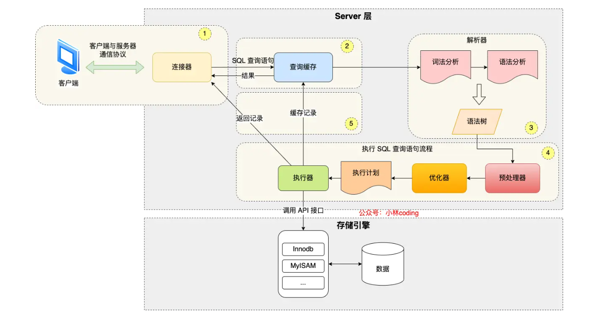

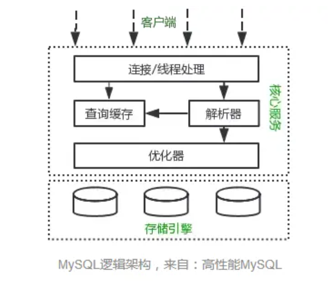

# 一行数据是如何存储的

**InnoDB 行格式有哪些？**

行格式（row_format），就是一条记录的存储结构。

InnoDB 提供了 4 种行格式，分别是 Redundant、Compact、Dynamic和 Compressed 行格式。

- Redundant 是很古老的行格式了， MySQL 5.0 版本之前用的行格式，现在基本没人用了。
- 由于 Redundant 不是一种紧凑的行格式，所以 MySQL 5.0 之后引入了 Compact 行记录存储方式，Compact 是一种紧凑的行格式，设计的初衷就是为了让一个数据页中可以存放更多的行记录，从 MySQL 5.1 版本之后，行格式默认设置成 Compact。
- Dynamic 和 Compressed 两个都是紧凑的行格式，它们的行格式都和 Compact 差不多，因为都是基于 Compact 改进一点东西。从 MySQL5.7 版本之后，默认使用 Dynamic 行格式。

**Dynamic 和 Compressed区别于Compact的主要特点就是溢出数据的处理**

Compact是存部分数据和指向溢出页的指针

Dynamic 和 Compressed是只存指向溢出页的指针

# COMPACT 行格式长什么样？

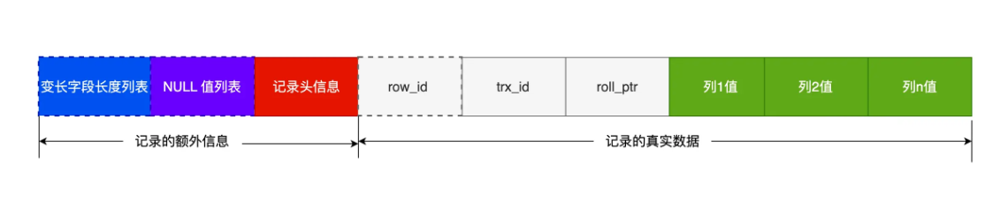

**变长字段的真实数据占用的字节数会逆序存放**

* **变长字段长度列表**

  记录变长字段的长度，是倒序存放的

* **NULL值列表**

  是NULL值就存1，非空就存0，后面真实数据部分不会再存值为空的数据，查找的时候是先看NULL值列表，如果为1就是空值，是0再查真实数据部分获取数据

* **记录头信息**

  东西比较多，重要的有下面几个

  - **delete_mask**：标识此条数据是否被删除。从这里可以知道，我们执行 detele 删除记录的时候，并不会真正的删除记录，只是将这个记录的 delete_mask 标记为 1。
  - **next_record**：下一条记录的位置。从这里可以知道，记录与记录之间是通过链表组织的。在前面我也提到了，指向的是下一条记录的「记录头信息」和「真实数据」之间的位置，这样的好处是向左读就是记录头信息，向右读就是真实数据，比较方便。
  - **record_type**：表示当前记录的类型，0表示普通记录，1表示B+树非叶子节点记录，2表示最小记录，3表示最大记录

* row_id

  没有主键也没有合适索引的时候才会生成，用来标识这行数据并组织B+树结构的

* trx_id（事务ID)

  每次修改这行数据时，都会记录下当时的事务 ID

* roll_ptr(回滚指针)

  指向 Undo Log 中的旧版本数据

**关于变长字段**

`VARCHAR(n)` 就是一个**会按实际内容大小来分配空间，且最多存放 n 个字符**的数据类型

注意是字符并不是字节，一个字符占几个字节由具体字符集决定

# 索引

**索引的目的就是提高一条语句的查询速度**

**索引的分类**

- 按「数据结构」分类：B+tree索引、Hash索引、Full-text索引。
- 按「物理存储」分类：聚簇索引（主键索引）、二级索引（辅助索引）。
- 按「字段特性」分类：主键索引、唯一索引、普通索引、前缀索引。
- 按「字段个数」分类：单列索引、联合索引。

## MySQL索引的最左前缀原则

**联合索引在使用时，必须从索引的最左列开始，连续地匹配索引中的列，才能有效利用索引**一旦跳过某个列，后续列的索引就无法被使用

# B+树的结构

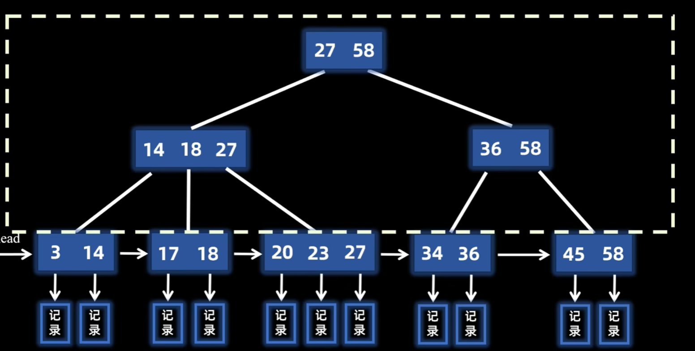

**B+树叶子节点存放数据，非叶子节点只存放索引**

**叶子节点存放的数据：聚簇索引存整行，二级索引存主键**

数据就存在叶子节点里，叶子节点里没有指针

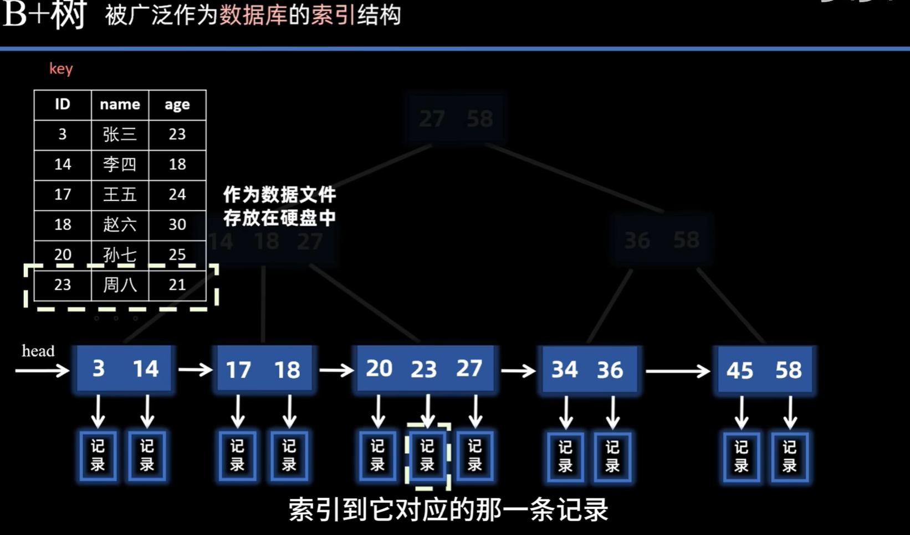

# 为什么使用B+树不用红黑树/二叉树？

MySQL是存储在磁盘上的，取数据的过程是先访问磁盘，将该节点的数据取到内存中，再用内存中的数据和需要查询的数据比较

整个过程中最耗时的部分就是访问磁盘，所以减少访问磁盘的次数可以大大提升性能

所以采用B+树这种一个节点多存点数据的结构

# 为什么使用B+树不用B树？

B+树是B树的变体，先看二者区别

* B树非叶子节点存数据，B+树不存
* B树叶子节点之间不用指针相连接，B+树有指针相连接

原因：

* B+树非叶子节点不存数据，就可以存更多索引键，降低树高减少IO次数
* B+树范围查询直接定位之后顺着链表查找比B树中序遍历快
  * 中序遍历是随机IO，比顺序IO慢
  * 中序遍历情况下预读机制难以生效

**覆盖索引**

**覆盖索引**是指：一条查询所需要的全部字段，都能从某个索引中直接获取，**无需回表**去一级索引（聚簇索引）取完整数据行。此时该索引"覆盖"了这次查询。

**索引区分度**

比如性别的区分度就很低

# **什么时候需要 / 不需要创建索引？**

索引最大的好处是提高查询速度，但是索引也是有缺点的，比如：

- 需要占用物理空间，数量越大，占用空间越大；
- 创建索引和维护索引要耗费时间，这种时间随着数据量的增加而增大；
- 会降低表的增删改的效率，因为每次增删改索引，B+ 树为了维护索引有序性，都需要进行动态维护。

所以，索引不是万能钥匙，它也是根据场景来使用的。

**什么时候适用索引？**

- 字段有唯一性限制的，比如商品编码；
- 经常用于 `WHERE` 查询条件的字段，这样能够提高整个表的查询速度，如果查询条件不是一个字段，可以建立联合索引。
- 经常用于 `GROUP BY` 和 `ORDER BY` 的字段，这样在查询的时候就不需要再去做一次排序了，因为我们都知道了建立索引之后在 B+Tree 中的记录都是排序好的。

**什么时候不需要创建索引？**

- `WHERE` 条件，`GROUP BY`，`ORDER BY` 里用不到的字段，索引的价值是快速定位，如果起不到定位的字段通常是不需要创建索引的，因为索引是会占用物理空间的。
- 字段中存在大量重复数据，不需要创建索引，比如性别字段，只有男女，如果数据库表中，男女的记录分布均匀，那么无论搜索哪个值都可能得到一半的数据。在这些情况下，还不如不要索引，因为 MySQL 还有一个查询优化器，查询优化器发现某个值出现在表的数据行中的百分比很高的时候，它一般会忽略索引，进行全表扫描。
- 表数据太少的时候，不需要创建索引；
- 经常更新的字段不用创建索引，比如不要对电商项目的用户余额建立索引，因为索引字段频繁修改，由于要维护 B+Tree 的有序性，那么就需要频繁的重建索引，这个过程是会影响数据库性能的。

# 优化索引的方法

* 前缀索引优化

  使用前缀索引优化，可以减少索引项的大小

  缺点：

  没办法排序

  没办法用作覆盖索引

* 覆盖索引优化

  用联合索引达成覆盖索引

* 主键索引最好是自增的

  自增的主键索引每插入一条新纪录都是追加操作，不需要大规模移动原有数据，不会引发页分裂

# 索引失效

### **模糊匹配**（准确来说是左模糊或者左右模糊匹配）

- 左模糊：`LIKE '%abc'` （以 abc 结尾）
- 右模糊：`LIKE 'abc%'` （以 abc 开头，这就是所谓的最左前缀匹配）
- 左右模糊（全模糊）：`LIKE '%abc%'` （只要包含 abc 即可）

现有的B+树结构就是从左到右比较的，所以只有右模糊能走普通索引直接查询，其他情况索引失效，只能全表扫描

### 对索引字段使用函数

索引存的是原始值，而不是经过函数计算的值，当然没办法索引

但是新增的MySQL功能添加了函数索引，即可以针对函数计算后的值建立一个索引

### 对索引进行表达式计算

### 对索引进行隐式类型转换

### 联合索引没遵循最左匹配原则

### 在 WHERE 子句中，如果在 OR 前的条件列是索引列，而在 OR 后的条件列不是索引列，那么索引会失效。

# 目录页

由于一次IO读取的数据是一页，所以把页当作基本单位比一条数据更合适

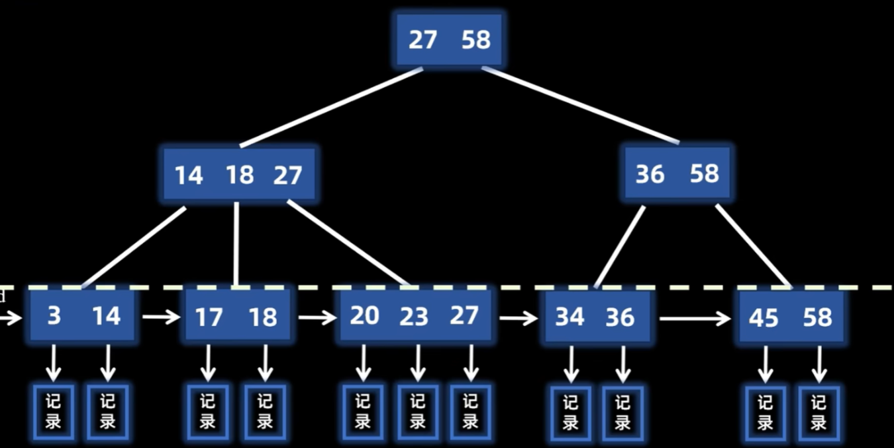

**每一个节点都是一个页**

**非叶子节点存的是目录，就是目录页**

**叶子节点存数据，就是数据页**

**页内部的结构**

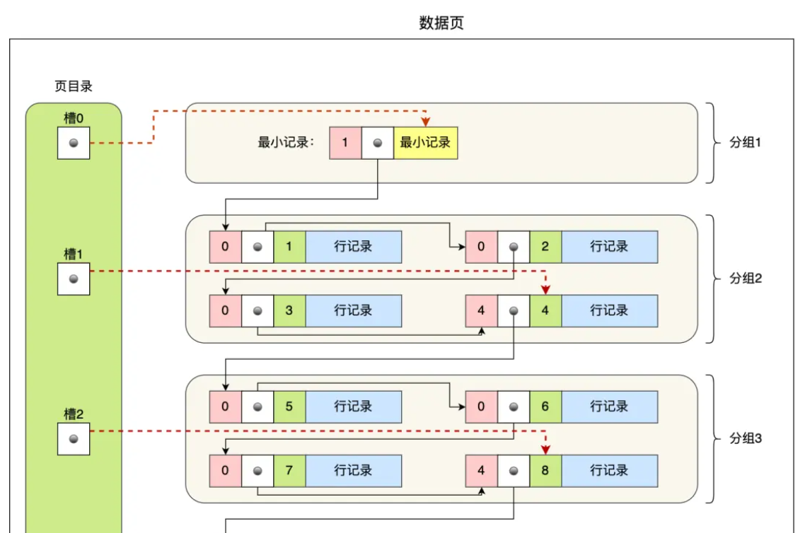

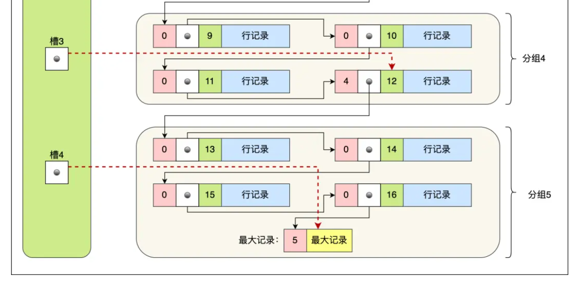

页目录创建的过程如下：

1. 将所有的记录划分成几个组，这些记录包括最小记录和最大记录，但不包括标记为“已删除”的记录；
2. 每个记录组的最后一条记录就是组内最大的那条记录，并且最后一条记录的头信息中会存储该组一共有多少条记录，作为 n_owned 字段（上图中粉红色字段）
3. 页目录用来存储每组最后一条记录的地址偏移量，这些地址偏移量会按照先后顺序存储起来，每组的地址偏移量也被称之为槽（slot），每个槽相当于指针指向了不同组的最后一个记录。

从图可以看到，页目录就是由多个槽组成的，槽相当于分组记录的索引。然后，因为记录是按照「主键值」从小到大排序的，所以我们通过槽查找记录时，可以使用二分法快速定位要查询的记录在哪个槽（哪个记录分组），定位到槽后，再遍历槽内的所有记录，找到对应的记录，无需从最小记录开始遍历整个页中的记录链表。

# ==还没看，看不下u==

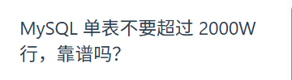

# 关于count（）的性能

* count(1)、count(*)、count(主键字段)在执行的时候，如果表里存在二级索引，优化器就会选择二级索引进行扫描。
* 所以，如果要执行 count(1)、count(*)、count(主键字段)时，尽量在数据表上建立二级索引，这样优化器会自动采用 key_len 最小的二级索引进行扫描，相比于扫描主键索引效率会高一些。
* 再来，就是不要使用 count(字段) 来统计记录个数，因为它的效率是最差的，会采用全表扫描的方式来统计。如果你非要统计表中该字段不为 NULL 的记录个数，建议给这个字段建立一个二级索引。
* `count()` 函数的底层逻辑是：**只有表达式的结果为 NULL 时，才不计数**，count(1)表达式为1，count(*)只看存在，所以count(1)、count(*)返回的是所有行数，count(主键字段)， count(字段) 返回的是数据不为NULL的行数。

# 为什么要通过遍历的方法来计数？

==和事务有关，看完MVCC再看==

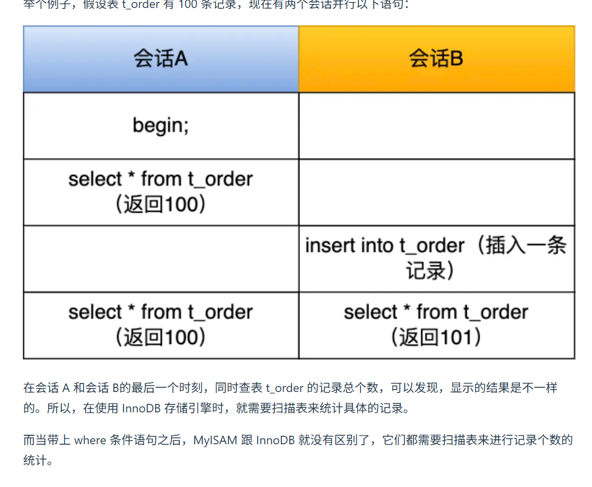

# 如何优化count（）

* 近似值

  使用 show table status 或者 explain 命令来表进行估算，不真正查询所以会快

* 维护计数表

  单独设立一个表保存计数值，但需要维护这个表

# ==那如果说我单独维护一张计数表，在会话A和B的最后时刻，应该读多少==

# 事务

多个事务并发执行时可能会遇到「脏读、不可重复读、幻读」的现象

- 脏读：读到其他事务未提交的数据；
- 不可重复读：前后读取的数据不一致；
- 幻读：前后读取的记录数量不一致。

## 事务隔离级别

就是事务之间互相的可见性

- **读未提交 (read uncommitted)**，指一个事务还没提交时，它做的变更就能被其他事务看到；
- **读已提交 (read committed)**，指一个事务提交之后，它做的变更才能被其他事务看到；
- **可重复读 (repeatable read)**，指一个事务执行过程中看到的数据，一直跟这个事务启动时看到的数据是一致的，MySQL InnoDB 引擎的默认隔离级别；就是其他事务的修改和我无关，提不提交我都看不到
- **串行化 (serializable )**；会对记录加上读写锁，在多个事务对这条记录进行读写操作时，如果发生了读写冲突的时候，后访问的事务必须等前一个事务执行完成，才能继续执行；

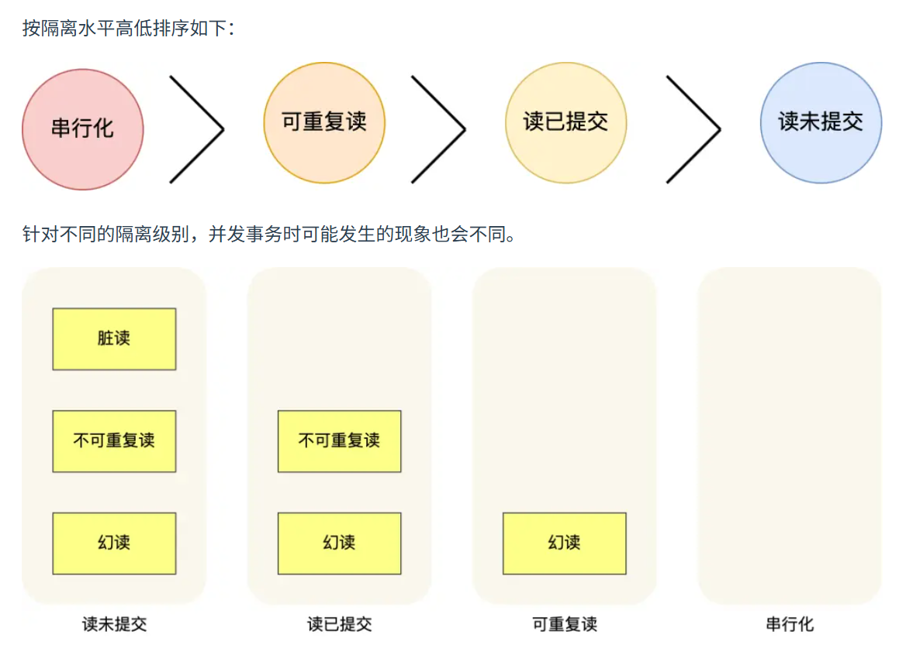

# MVCC（多版本并发控制）

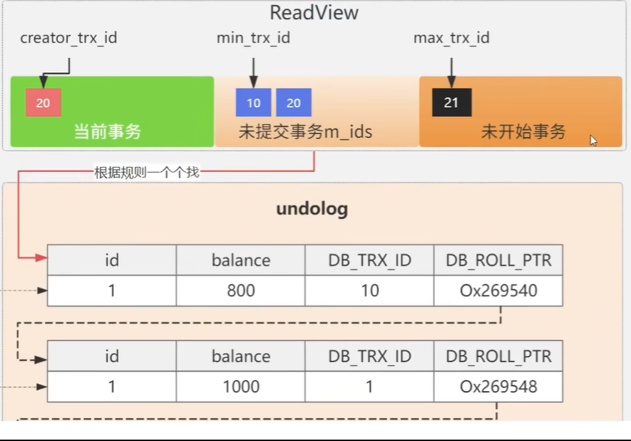

## undo log里后两个是事务id和指向上一个版本的指针

**判断的过程：**

* 如果被访问的记录版本号等于当前事务自己的 ID，表明这个版本是**当前事务自己修改的**，数据可见。

* 如果被访问的记录版本号小于最小活跃事务 ID（min_trx_id），表明该版本的数据在生成读取视图之前就已经被**已提交的事务**修改，该版本的数据可以被访问（可见）；

* 如果被访问的记录版本号大于或等于最大事务 ID 值（max_trx_id），表明生成该版本的事务是在读取视图生成之后才开启的**未开始事务**，不可以被访问，需要沿着回滚指针寻找该记录的历史版本继续判断；

* 如果被访问的记录版本号介于最小活跃事务 ID 和最大事务 ID 之间（图例中 10 <= DB_TRX_ID < 21），需要判断该版本号是否在活跃事务列表中（m_ids）：
  * **如果在：** 说明创建读取视图时生成该版本的事务是**尚未提交的事务**（图二中的 10），该版本数据不可见，需要沿着回滚指针寻找该记录的历史版本继续判断；
  * **如果不在：** 说明创建读取视图时生成该版本的事务是**已提交的事务**，该版本数据可见。

## 读已提交

是每次读数据都生成一个快照，保证数据随每次修改更新

## 可重复读

启动事务时生成一个快照，然后在整个事务期间都使用这个快照

# 当前读与快照读

前面的MVCC都是针对快照读的，当前读实行的是另一种方法，当前读和快照读它们各自负责不同的场景，使用不同的实现方式

* **当前读**：读最新数据，加锁
* **快照读：**读历史版本数据，使用MVCC

==当前读的实现原理==

# ==锁==

* ## 全局锁

  备份的时候用，全局锁开启后不能进行增删改操作，可以备份的时候开启一个事务，采用可重复读的模式来替代全局锁，这样增删改操作不受影响

* ## 表级锁

  * **表锁**

  

  表锁除了会限制别的线程的读写之外，也会限制本线程接下来的读写操作，在锁生效时本线程不能进行其他操作

  * **元数据锁**（MDL）

    我们不需要显示的使用 MDL，因为当我们对数据库表进行操作时，会自动给这个表加上 MDL：

    * 对一张表进行 CRUD 操作时，加的是 MDL 读锁；

    * 对一张表做结构变更操作的时候，加的是 MDL 写锁；

    MDL 是为了保证当用户对表执行 CRUD 操作时，防止其他线程对这个表结构做了变更。

    **MDL 是在事务提交后才会释放，这意味着事务执行期间，MDL 是一直持有的。所以为了能安全的对表结构进行变更，在对表结构变更前，先要看看数据库中的长事务，是否有事务已经对表加上了 MDL 读锁，如果可以考虑 kill 掉这个长事务，然后再做表结构的变更。**

  * **意向锁**

    - 在使用 InnoDB 引擎的表里对某些记录加上「共享锁」之前，需要先在表级别加上一个「意向共享锁」；
    - 在使用 InnoDB 引擎的表里对某些记录加上「独占锁」之前，需要先在表级别加上一个「意向独占锁」；

    意向共享锁和意向独占锁是表级锁，不会和行级的共享锁和独占锁发生冲突，而且意向锁之间也不会发生冲突，只会和共享表锁和独占表锁发生冲突。

    如果没有「意向锁」，那么加「独占表锁」时，就需要遍历表里所有记录，查看是否有记录存在独占锁，这样效率会很慢。

    那么有了「意向锁」，由于在对记录加独占锁前，先会加上表级别的意向独占锁，那么在加「独占表锁」时，直接查该表是否有意向独占锁，如果有就意味着表里已经有记录被加了独占锁，这样就不用去遍历表里的记录。

  所以，**意向锁的目的是为了快速判断表里是否有记录被加锁。**

  * **AUTO-INC锁**

    

* ## 行锁

  | 锁类型     | 英文名        | 锁定范围                           | 作用                                            | 关键特点                                                     |
  | :--------- | :------------ | :--------------------------------- | :---------------------------------------------- | :----------------------------------------------------------- |
  | **记录锁** | Record Lock   | 索引记录本身                       | 锁住某条索引记录，阻止其他事务更新/删除该行     | 最基础的行锁；即使无显式索引，也依赖隐藏聚簇索引；分 S/X 模式 |
  | **间隙锁** | Gap Lock      | 索引记录之间的间隙（不含记录本身） | 阻止其他事务在间隙中插入新数据，防止幻读        | 间隙锁之间互相兼容；仅用于阻止插入；读已提交级别下通常禁用   |
  | **临键锁** | Next-Key Lock | 左开右闭区间 `(a, b]`              | 记录锁 + 间隙锁的组合，既锁记录又锁记录前的间隙 | 可重复读隔离级别下的**默认加锁单位**；用于范围查询/非唯一索引等值查询 |

# MySQL加锁

- **读未提交**：基本不加锁，允许脏读
- **读已提交**：读不加锁（MVCC），写加行锁
- **可重复读**（InnoDB 默认）：MVCC + 间隙锁/临键锁，防止幻读
- **串行化**：读也加共享锁，完全串行

**当前读加锁的目的，是保证读到的数据在被使用或修改之前不被其他事务改动，从而避免并发下的丢失更新和幻读。**

# ==MySQL是怎么加行级锁的？==

**唯一索引（主键索引）和非唯一索引（二级索引）的区别就是二级索引要把临界值周围的间隙全都锁上，主键索引是按照索引排序的，二级索引是根据二级索引和主键排序的，类似于比较的是二级索引值.主键值**

**如图所示，这里就相当于锁的是22.1-39.2**

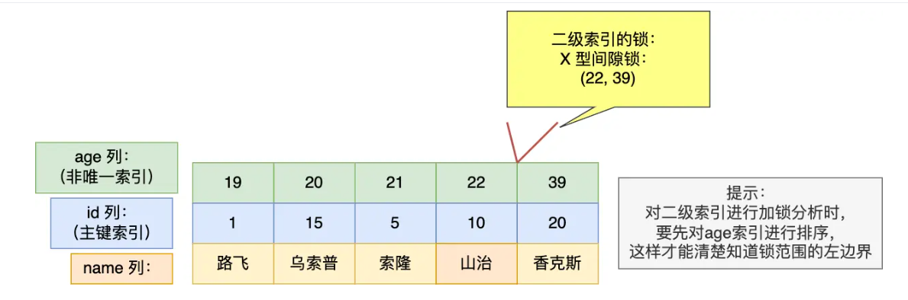

### **每个情况的图示**

### 唯一索引（主键索引）等值查询

* 查询结果存在

  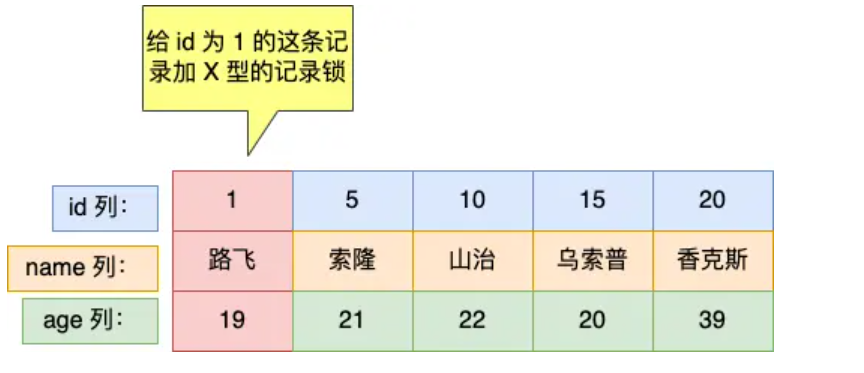

* 查询结果不存在

  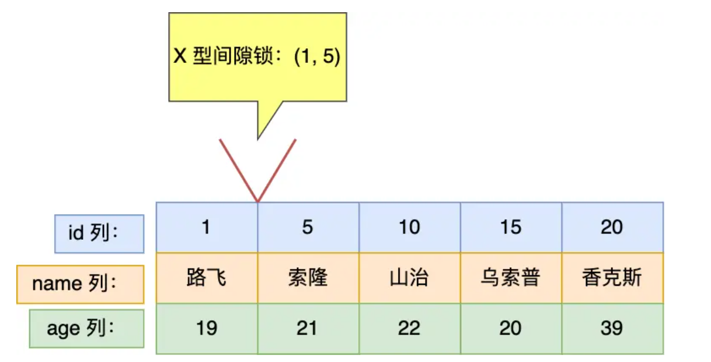

### 唯一索引（主键索引）范围查询

* 大于

  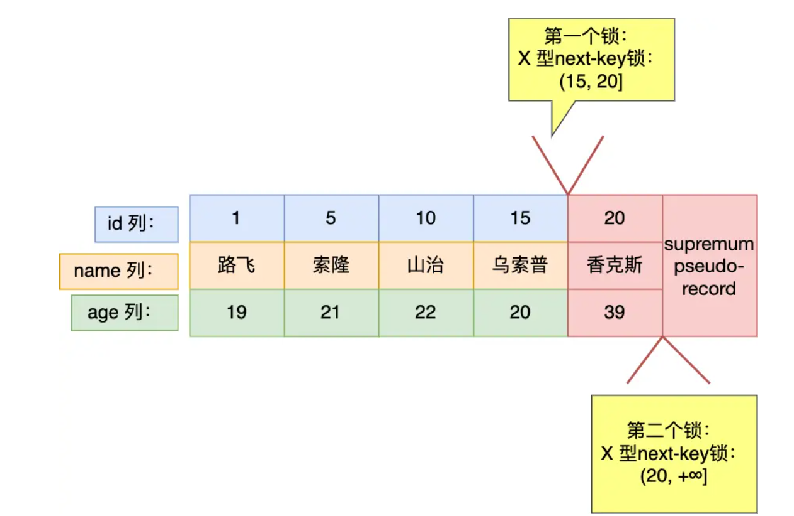

* 大于等于

  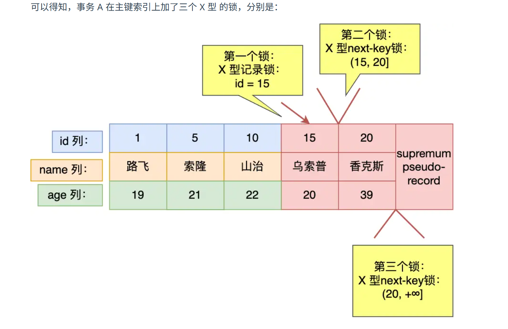

### 非唯一索引等值查询

* **记录不存在**

  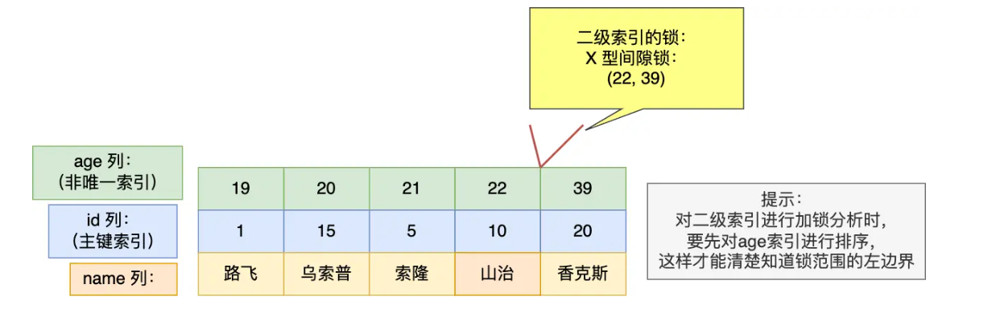

* **记录存在**

  

### 非唯一索引范围查询

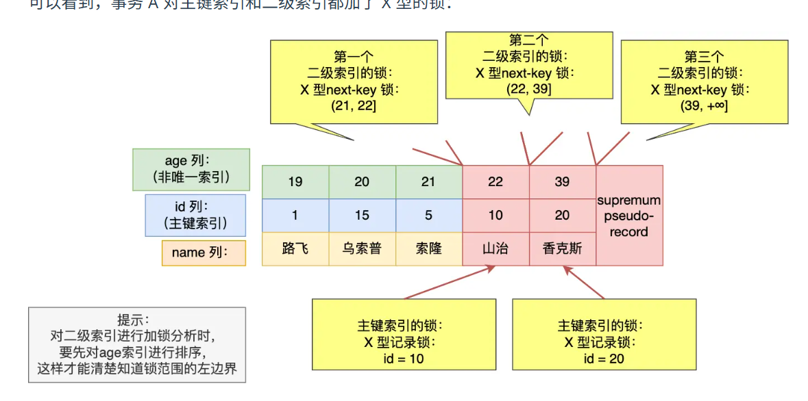

### 没有索引全表锁

# 死锁

**死锁的产生需要同时满足四个条件（Coffman 条件），缺一不可：**

1. **互斥**：资源一次只能被一个事务占用（MySQL 的排他锁天然满足）。
2. **持有并等待**：一个事务已持有锁，同时又在等待其他锁，且不释放已持有的锁。
3. **不可剥夺**：锁只能由持有者主动释放，不能被强行抢占。
4. **循环等待**：存在一个事务等待环，A 等 B、B 等 C、C 等 A。

# 日志

- ### **undo log（回滚日志）**：

  是 Innodb 存储引擎层生成的日志，实现了事务中的**原子性**，主要**用于事务回滚和 MVCC**。

  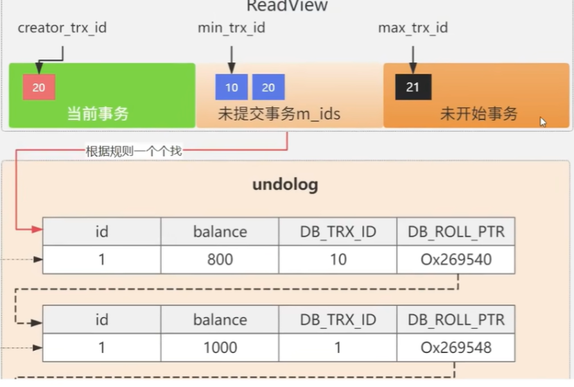

- ### **redo log（重做日志）**：

  是 Innodb 存储引擎层生成的日志，实现了事务中的**持久性**，主要**用于掉电等故障恢复**；

  redo log 是物理日志，记录了某个数据页做了什么修改，比如**对 XXX 表空间中的 YYY 数据页 ZZZ 偏移量的地方做了 AAA 更新**，每当执行一个事务就会产生这样的一条或者多条物理日志。

  > redo log 要写到磁盘，数据也要写磁盘，为什么要多此一举？

  写入 redo log 的方式使用了追加操作， 所以磁盘操作是**顺序写**，而写入数据需要先找到写入位置，然后才写到磁盘，所以磁盘操作是**随机写**。

  磁盘的「顺序写 」比「随机写」 高效的多，因此 redo log 写入磁盘的开销更小。

  **WAL 技术**

  WAL 技术指的是， MySQL 的写操作并不是立刻写到磁盘上，而是先写日志，然后在合适的时间再写到磁盘上。

- ### **binlog（归档日志）**：

  是 Server 层生成的日志，主要**用于数据备份和主从复制**；

# 两阶段提交

我们完整看一下执行 `UPDATE T SET c=c+1 WHERE id=1;` 的过程：

1. **执行器**先找引擎取 `id=1` 这一行。引擎在 Buffer Pool 中查找，如果不在，就从磁盘读入内存，返回给执行器。
2. 执行器拿到数据，把 `c` 的值加 1，得到新数据，然后调用引擎接口写入这行新数据。
3. **引擎**将这行新数据更新到内存中，同时将这个更新操作记录到 **redo log** 里面。此时，redo log 处于 **prepare（准备）状态**。然后告知执行器：“我准备好了，随时可以提交”。
4. **执行器**收到通知后，生成这个操作的 **binlog**，并把 binlog 写入磁盘。
5. **执行器**调用引擎的提交事务接口。
6. **引擎**把刚刚写入的 redo log 改成 **commit（提交）状态**，更新完成。

因为redo log和 binlog 如果分别提交，就会发生主从不一致的问题，所以利用两阶段提交**保证两个不同层面的日志（InnoDB 引擎层的 redo log 和 Server 层的 binlog）在崩溃恢复时的一致性，从而确保主库和从库的数据绝对一致。**

两阶段提交会产生一些问题：

- **磁盘 I/O 次数高**：对于“双1”配置，每个事务提交都会进行两次 fsync（刷盘），一次是 redo log 刷盘，另一次是 binlog 刷盘。
- **锁竞争激烈**：两阶段提交虽然能够保证「单事务」两个日志的内容一致，但在「多事务」的情况下，却不能保证两者的提交顺序一致，因此，在两阶段提交的流程基础上，还需要加一个锁来保证提交的原子性，从而保证多事务的情况下，两个日志的提交顺序一致。

可以利用组提交的方式解决，把提交分成组，一组提交一次，每组上一个锁

# Buffer Pool（缓冲池）

- 当读取数据时，如果数据存在于 Buffer Pool 中，客户端就会直接读取 Buffer Pool 中的数据，否则再去磁盘中读取。
- 当修改数据时，首先是修改 Buffer Pool 中数据所在的页，然后将其页设置为脏页，最后由后台线程将脏页写入到磁盘。

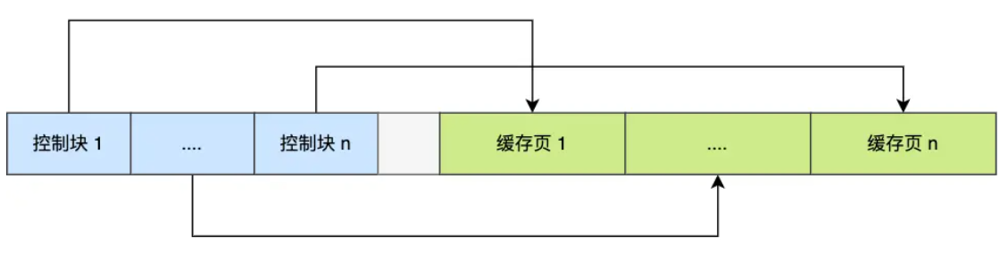

**控制块：**

控制块信息包括「缓存页的表空间、页号、缓存页地址、链表节点」等等。

上图中控制块和缓存页之间灰色部分称为**碎片空间**。

> 为什么会有碎片空间呢？

你想想啊，每一个控制块都对应一个缓存页，那在分配足够多的控制块和缓存页后，可能剩余的那点儿空间不够一对控制块和缓存页的大小，自然就用不到喽，这个用不到的那点儿内存空间就被称为碎片了。

### **如何管理空闲页？**

Buffer Pool 是一片连续的内存空间，当 MySQL 运行一段时间后，这片连续的内存空间中的缓存页既有空闲的，也有被使用的。

所以，为了能够快速找到空闲的缓存页，可以使用链表结构，将空闲缓存页的「控制块」作为链表的节点，这个链表称为 **Free 链表**（空闲链表）。

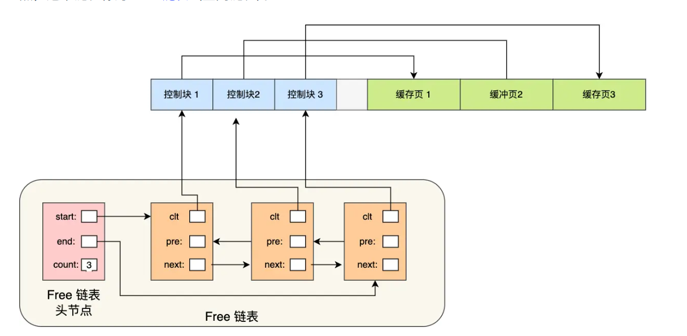

Free 链表上除了有控制块，还有一个头节点，该头节点包含链表的头节点地址，尾节点地址，以及当前链表中节点的数量等信息。

Free 链表节点是一个一个的控制块，而每个控制块包含着对应缓存页的地址，所以相当于 Free 链表节点都对应一个空闲的缓存页。

有了 Free 链表后，每当需要从磁盘中加载一个页到 Buffer Pool 中时，就从 Free链表中取一个空闲的缓存页，并且把该缓存页对应的控制块的信息填上，然后把该缓存页对应的控制块从 Free 链表中移除。

### 如何管理脏页？

设计 Buffer Pool 除了能提高读性能，还能提高写性能，也就是更新数据的时候，不需要每次都要写入磁盘，而是将 Buffer Pool 对应的缓存页标记为**脏页**，然后再由后台线程将脏页写入到磁盘。

链表形式和空闲页一样

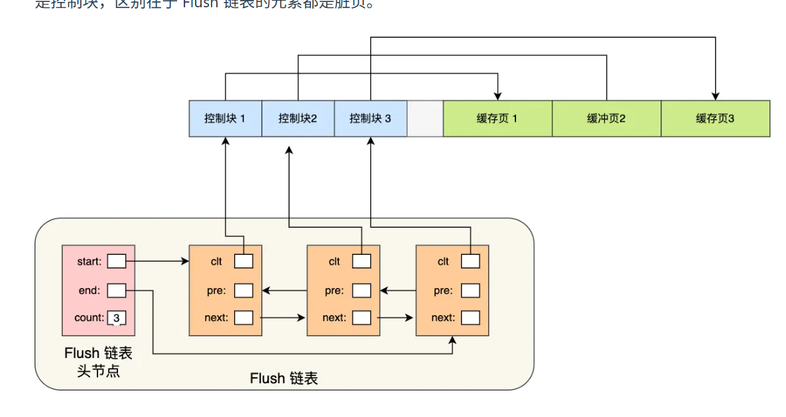

### 脏页什么时候会被刷入磁盘？

**脏页需要被刷入磁盘，保证缓存和磁盘数据一致，但是若每次修改数据都刷入磁盘，则性能会很差，因此一般都会在一定时机进行批量刷盘**

可能大家担心，如果在脏页还没有来得及刷入到磁盘时，MySQL 宕机了，不就丢失数据了吗？

这个不用担心，InnoDB 的更新操作采用的是 Write Ahead Log 策略，即先写日志，再写入磁盘，通过 redo log 日志让 MySQL 拥有了崩溃恢复能力。

下面几种情况会触发脏页的刷新：

- 当 redo log 日志满了的情况下，会主动触发脏页刷新到磁盘；
- Buffer Pool 空间不足时，需要将一部分数据页淘汰掉，如果淘汰的是脏页，需要先将脏页同步到磁盘；
- MySQL 认为空闲时，后台线程会定期将适量的脏页刷入到磁盘；
- MySQL 正常关闭之前，会把所有的脏页刷入到磁盘；

### 如何提高缓存命中率？

常见的有LRU算法，但是MySQL并没有使用简单的LRU算法

简单的 LRU 算法并没有被 MySQL 使用，因为简单的 LRU 算法无法避免下面这两个问题：

- 预读失效；

  一次预读可能读很多页，未被使用的页进入缓存替换掉了实际应该在缓存中的热点页

- Buffer Pool 污染；

  当某一个 SQL 语句**扫描了大量的数据**时，在 Buffer Pool 空间比较有限的情况下，可能会将 **Buffer Pool 里的所有页都替换出去，导致大量热数据被淘汰了**，等这些热数据又被再次访问的时候，由于缓存未命中，就会产生大量的磁盘 IO，MySQL 性能就会急剧下降，这个过程被称为 **Buffer Pool 污染**。

InnoDB 对 LRU 做了一些优化，我们熟悉的 LRU 算法通常是将最近查询的数据放到 LRU 链表的头部，而 InnoDB 做 2 点优化：

- 将 LRU 链表分为 **young 和 old 两个区域**，加入缓冲池的页，优先插入 old 区域；页被访问时，才进入 young 区域，目的是为了解决预读失效的问题。

- 当**「页被访问」且「 old 区域停留时间超过 `innodb_old_blocks_time` 阈值（默认为1秒）」**时，才会将页插入到 young 区域，否则还是插入到 old 区域，目的是为了解决批量数据访问，大量热数据淘汰的问题。

  **这个机制的精妙之处在于：** 全表扫描的速度极快（通常远小于 1 秒）

  全表扫描进来的数据不到一秒就会被后进来的全表扫描数据挤走，避免了大量热数据淘汰的问题

可以通过调整 `innodb_old_blocks_pct` 参数，设置 young 区域和 old 区域比例。
