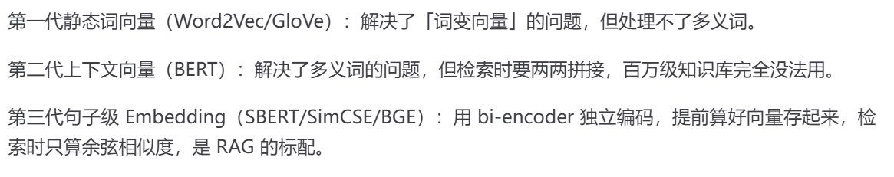
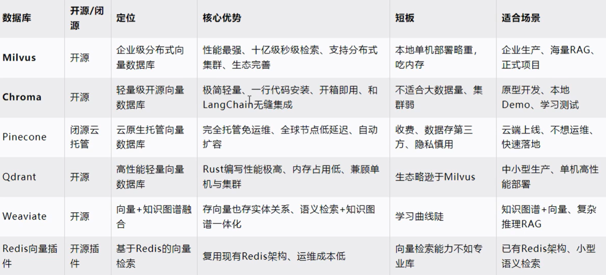
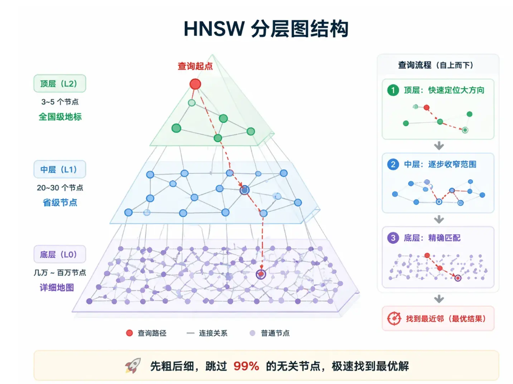
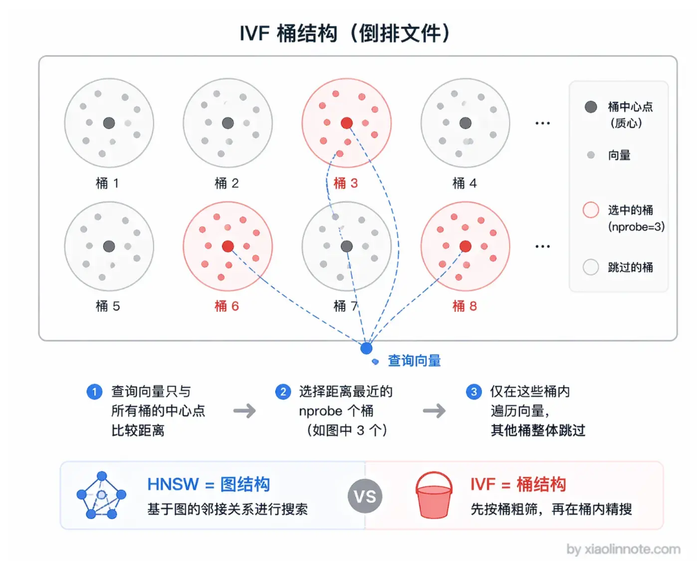
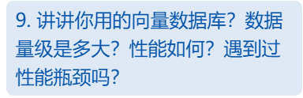
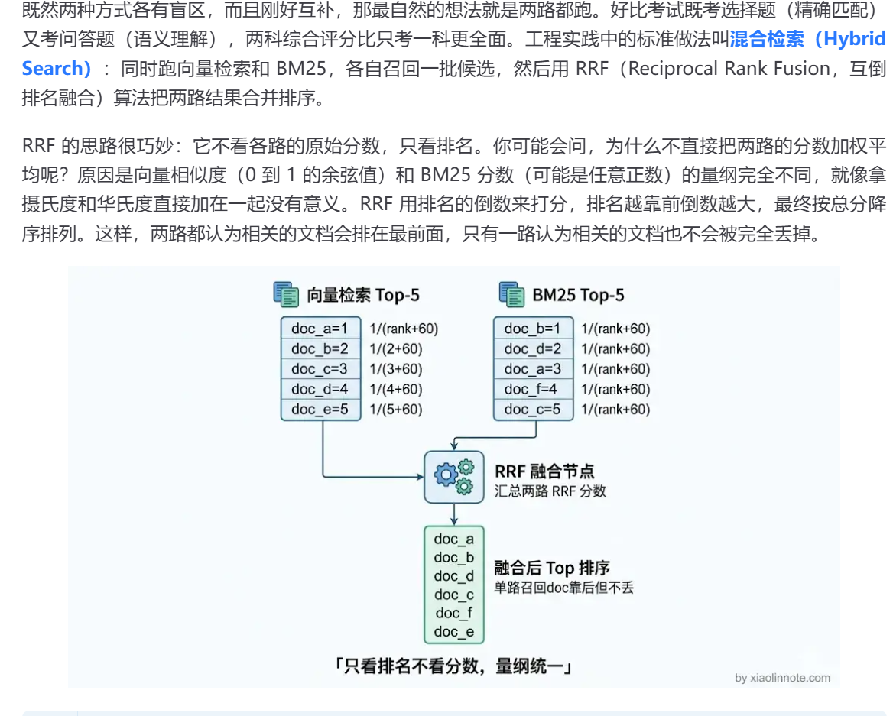
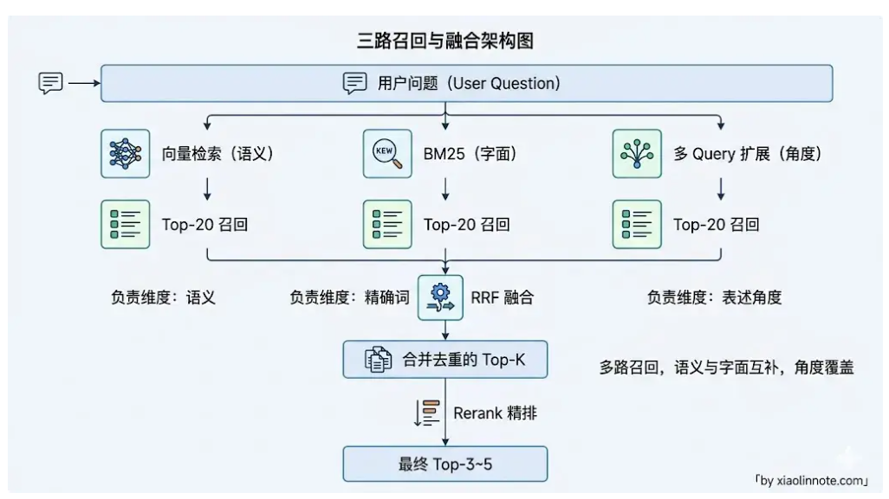
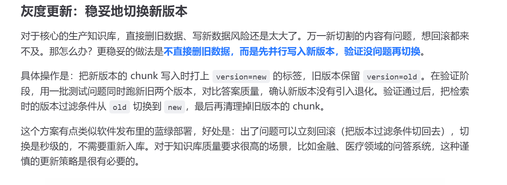
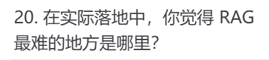
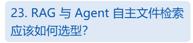

# RAG小林八股

**检索增强生成**

作用：在生成答案之前先去外部知识库里检索相关内容，将检索结果和用户问题一起交给LLM，在原有知识的基础上给大模型添加私有数据和最新数据

知识冻结-->开卷考试

#### RAG核心价值

* 知识可以随时热更新，往知识库里加新文档就行，不需要重新训练模型，成本极低
* 私有知识覆盖，比如公司内部文档不会进入训练集，同时也能做好保密工作
* 答案有溯源，每条回答都能追溯到来自哪个 chunk，可解释性比纯 LLM 生成强很多，遇到答错了也知道是哪条知识出了问题

##### RAG是怎么溯源的？

分块的时候会带上这个文章的id 然后检索的时候要llm提供这个id就好了

#### 离线阶段--建库

* 文档加载


* 文档切割

  ##### 为什么要chunking？

  * 向量模型有输入限制
  * 一次性压缩过多内容会导致信息过于笼统

  每个chunk分别向量化后会存成一条记录

  **每条 chunk 记录的结构**？

  * **向量**

    向量用于相似度检索

  * **原文**

    原始文本是检索命中之后塞给 LLM 读的内容

  * **metadata**

    metadata 是来源文件、页码这些附加信息，用于过滤和溯源

  #### 文档切割策略？

  * **固定大小切割加重叠**

  * **语义边界切割**

    语义切割的核心思路，是**让文本的切分点落在“语义发生明显转折”的地方**

    语义切割的过程

    * 先按照标点切分成句子
    * embedding
    * 用滑动窗口计算相邻句子向量的相似度
    * 相似度低的就代表语义转折，在这里设置断点
    * 根据确定的断点，确定最终的 Chunk

  * **特殊内容专项处理**

    对于代码和表格这两种形式的文本需要单独处理

    代码以函数或者类为单位切割，保证每个 chunk 都是完整可理解的代码逻辑单元。

    格则要整块保留，转成 Markdown 格式存储，不能按行截断。表格的每一行都依赖表头才有意义，「2 小时」单独来看完全不知道是什么的 2 小时，但配上列名「响应时间：2 小时」就清晰多了。把整张表格作为一个完整 chunk，才能保留列的含义和行间的对比关系。

  * **父子切割**

    存储时，同一段内容存两份。一份是细粒度的小 chunk（比如 200 token），专门用于向量检索，因为小 chunk 语义聚焦，围绕一个小话题，检索精度高。另一份是包含这个小 chunk 前后上下文的大 chunk（比如 1000 token），通过 ID 与对应的小 chunk 关联。检索时用小 chunk 找到精准的命中点，然后根据关联 ID 取出对应的大 chunk，把完整的上下文交给 LLM 阅读，生成质量更好。

    缺点：存储量翻倍，索引构建也更复杂

  * **命题化切割**

  用 LLM 把文档分解成一条条独立的「命题」（Proposition）。每个命题是一个完整、自包含的陈述句，包含了表达这个事实所需的全部上下文，单独拿出来就能看懂，不依赖上下文，只包含一个核心事实

  质量最好，成本也最高，要调用大模型生成命题

* 向量化

* 入库

  把每个 chunk 的向量和原始文本一起存进向量数据库

#### 在线阶段-用户提问时实时检索

* Query处理

  用户提出的问题不能直接用于检索，用户的用语可能是口语化的，有指代的，所以要先处理再用于检索

  **解决方案**

  * **简单改写，将口语化改为正式**
  * **使用假设答案， HyDE，让 LLM 先生成一个假设答案，拿假设答案去搜索，问题和答案的用词往往差异很大，但假设答案和真实答案的用词更接近，它们的语义空间天然更匹配，命中率往往更高。**
  * **角度扩写，把同一个问题扩展成 3-5 种不同表述，分别检索后合并结果，覆盖面更广**

* Query向量化

  必须用和离线建库时完全相同的 Embedding 模型。相当于是保证坐标系一致

* 向量检索（粗排）

  不做语义理解，只做关键词匹配或者近似向量检索

* Rerank（精排）

  通过语义理解进行打分，选最接近的几个， Rerank 是 Cross-Encoder 结构，需要把查询和每个候选拼在一起过模型

* 生成

  拼到promopt里发给大模型生成

#### AI幻觉

###### 在大语言模型语境下，幻觉是指模型生成的内容在语义表层呈现出流畅、连贯且语法正确的自然语言形式，但在事实准确性（Factual Accuracy）、与输入上下文的逻辑一致性（Contextual Consistency）或与世界常识（World Knowledge）的匹配度上，存在无中生有、信息扭曲或逻辑悖谬的现象。

**大模型的本质是预测下一个字，所以在面对自身没有的知识时并不会停下来，而是一本正经的胡说八道**

#### 模型微调

模型微调是指让一个已经过海量通用数据预训练的大模型，在特定领域的小规模数据集上继续进行有监督训练。

其核心目的是“定向适配”：通过更新部分或全部模型参数，将模型的通用语言能力“迁移”到特定任务（如医疗问诊、代码生成）上，从而显著提升其在专业场景下的准确率和输出规范性。

## Late Chunking

### 向量化是一个怎样的过程？为什么late chunking能够让小块向量融入全文内容？

**主要区别在 Transformer阶段， Transformer阶段token向量通过文本信息内部的相互流通融入上下文，late chunking使能够沟通的信息扩大到整篇文本，于是每个chunking都可以实现高度上下文相关**

具体RAG流程如下：

```
原始长文档
    ↓
① 分块（Chunking）—— 先切成多个短文本
    ↓
② 对每个 chunk 独立做 Tokenization
    ↓
③ 每个 chunk 独立查表得到初始 Embedding + 位置编码
    ↓
④ 每个 chunk 过完整的 Transformer 层（Self-Attention 只在当前 chunk 内部发生）
    ↓
⑤ 对每个 chunk 做 Mean Pooling（或取 [CLS]）
    ↓
得到多个独立的 chunk 向量
    ↓
存入向量数据库
```

**1 对每个 Chunk 独立 Tokenization**
每个 chunk 单独送入分词器，变成 token 序列。
例子（Chunk 2）：
“The city has a rich history.”

```
→ ["The", "city", "has", "a", "rich", "history", "."]
```

**2 初始 Embedding + 位置编码**

- 查 Embedding Table，得到每个 token 的初始向量。
- 加上位置编码（告诉模型“我是这个短 chunk 里的第几个位置”）。

此时的向量**只包含当前 chunk 内部的词义和位置**，完全不知道前面有“Berlin”。

**3 Transformer 层（关键差异点）**

*  **Multi-Head Self-Attention（自注意力）**

对每个 token，模型会计算它与**序列中所有其他 token** 的相关性（注意力分数），然后按分数加权聚合其他 token 的信息。

* **Feed-Forward Network + 残差连接 + LayerNorm**

进一步非线性变换，让表示更丰富。

##### 普通RAG  

每个 chunk **单独**完整地跑一遍多层 Transformer。

- Self-Attention 只在**当前 chunk 的 token 之间**计算。
- 信息只能在当前短文本内部流动。
- 例如 Chunk 2 里的 “The city”，最多只能看到 “has a rich history”，**永远看不到**前面的 “Berlin”。

经过多层之后，每个 token 的最终表示**只融合了本 chunk 的上下文**。 

**Late Chunking**

信息可以在整篇文本内部流动，每个token的向量都可以吸收整个序列里相关的内容

##### 4 Pooling

* 把属于某个范围的所有 token 向量取平均（有时会忽略 padding 或特殊 token）。

* 得到一个固定维度的稠密向量（比如 768 维或 1024 维）。

## 如何解决语义被切割掉的问题？

##### 第一个方面是切割过程

* 重叠切割
* 语义边界切割

尽量在切的时候就不要在语义中间截断

##### 第二个方面是检索过程

* 句子窗口检索

存储时把文档切成单个句子，每个句子单独做向量，用于精准检索；检索命中一个句子后，并不只返回这一个句子，而是把这个句子前后各 N 个句子一起返回，形成一个上下文窗口，交给 LLM 阅读。

* 父子切割

用小chunk检索，用大chunk生成，两者通过ID 关联

* 命题化切割

用 LLM 把文档分解成一条条独立的「命题」（Proposition）。每个命题是一个完整、自包含的陈述句，包含了表达这个事实所需的全部上下文，单独拿出来就能看懂，不依赖上下文，只包含一个核心事实

举个例子

用 LLM 把文档分解成一条条独立的「命题」（Proposition）。每个命题是一个完整、自包含的陈述句，包含了表达这个事实所需的全部上下文，单独拿出来就能看懂，不依赖上下文，只包含一个核心事实

质量最好，成本也最高，要调用大模型生成命题

==Contextual Retrieval==还没看，记得看

# embedding模型有哪些？

• 第一类是 **OpenAI 的 text-embedding 系列**，`text-embedding-3-small` 是性价比最高的，1536 维，支持降维到 256 维来节省存储，调用方便，英文效果非常好；缺点是 API 调用有费用，而且数据要发到 OpenAI 服务器，有些企业有数据出境合规问题。

• 第二类是 **BGE 系列（北京智源研究院出品）**，`bge-large-zh-v1.5` 是经典的中文开源模型，1024 维，可以本地部署，数据不出境。不过要注意的是，BGE 虽然仍然是很好的选择，但已经不是中文场景的唯一首选了。`bge-m3` 是 BGE 的多语言版本，同时支持中英日等多种语言，1024 维，而且支持三种检索模式（稠密向量、稀疏向量、ColBERT 式多向量），适合中英文混排的场景。

• 第三类是**新一代高性能模型**，这两年涌现了一批在 MTEB 排行榜上超过 BGE 的模型。`Qwen3-Embedding`（阿里通义出品）在多语言基准上表现突出，中文效果很强；`Voyage-3-large` 在英文检索上精度超过 OpenAI 的模型；`Cohere embed-v4` 支持 128K 超长上下文，适合长文档场景；`Gemini Embedding`（Google 出品）在多个评测中表现均衡。如果你在 2025-2026 年做新项目，建议关注这些新模型，在自己的数据上做测评后再选型。

# 如何选择embedding模型？

* 第一是**中英文比例**：知识库以中文为主，可以选 `bge-large-zh-v1.5` 或者更新的 `Qwen3-Embedding`；中英混合，选 `bge-m3`；纯英文或追求省事，选 `text-embedding-3-small`。

* 二是**数据合规要求**：数据不能出境，就必须用可以本地部署的开源模型，BGE 系列和 Qwen3-Embedding 都是很好的选择。

* 第三是**向量维度**对存储和检索速度的影响：维度越高精度越好，但存储空间和检索时间都会增加。百万量级的知识库，1024 维是个合理的平衡点；如果规模很小，1536 维也无所谓。有些新模型（如 text-embedding-3-small）支持 Matryoshka 降维，可以灵活调整维度来平衡精度和成本。

# embedding有哪几种算法？



# 向量数据库

选向量数据库主要看三个维度：数据规模、部署方式、是否需要混合检索。

中小到大规模、团队小、快速上线，首选 **Qdrant**，性能好、API 设计简洁、文档完善，Docker 一条命令就能部署，Rust 写的性能很稳。Qdrant 现在也支持分布式模式（分片 + 副本），实际已经有亿级规模的生产案例，覆盖面比较广。很多团队一开始用 Chroma 做原型，后来上生产就切到 Qdrant，这个路径很常见。

说到 **Chroma**，它确实是上手最快的选项，Python 直接 `pip install`，本地内存运行，零配置，配合 LangChain/LlamaIndex 原生集成非常方便。Chroma 现在也支持了 Client-Server 模式和 Chroma Cloud 托管服务，不再只是本地嵌入式了，而且在 2025 年还加入了 BM25/SPLADE 稀疏向量的混合检索支持。不过要注意的是，Chroma 的分布式能力还在成熟中，对于超大规模（千万级以上）的生产场景，它的稳定性和性能还不如 Milvus 和 Qdrant 这些专门为大规模设计的方案。总结来说，Chroma 适合快速原型验证和中小规模的生产使用，超大规模就要考虑其他选项了。

数据规模在千万到亿级，需要分布式，选 **Milvus**，国内大厂用得最多，支持多种索引类型，有完整的集群方案，但部署运维复杂度也高，团队需要有足够的人力来维护。

不想运维，数据在云上，用 **Pinecone**，全托管 SaaS，按用量付费，适合快速验证商业化产品。不过要注意数据出境的问题，如果业务数据有合规要求，Pinecone 就不合适了。

已经在用 PostgreSQL，数据量不是特别大，可以直接用 **pgvector** 插件，不用引入新组件，查询可以和业务数据做 SQL JOIN，运维成本为零。



# 向量数据库的核心索引算法

## HNSW（Hierarchical Navigable Small World）

## 分层可导航小世界

**精度高，占内存大**



## **IVF（Inverted File Index）**

### 桶结构倒排文件

**精度低，占内存小**



# ==做项目的时候完善这个==



# 关键词检索

* ## 离线建索引

  1. **文档收集与预处理**：获取原始文本（TXT、PDF、网页等），去除 HTML 标签、乱码等噪声。
  2. **分词（Tokenization）**：
     - **英文**：按空格和标点切分，并进行**词干提取**（如 running 变 run）和**停用词过滤**（去掉 the, is 等）。
     - **中文**：使用分词工具（如 Jieba、HanLP）切分成词，或者使用 N-gram 切分。*中文分词的准确性直接决定了检索效果。*
  3. **构建倒排索引（Inverted Index）**：
     - 这是关键词检索的核心数据结构。它记录的是 **“词项（Term） -> 包含该词的文档列表（Posting List）”** 的映射关系。
     - 与正排索引（文档 -> 包含的词）相比，倒排索引能让系统在搜索时，直接通过词找到文档，而不需要遍历所有文档，极大提升了速度。
  4. **统计与计算权重**：
     - 在建立倒排索引的同时，统计每个词在每篇文档中的**词频（TF）**、该词在整个语料库中的**文档频率（DF）**，以及每篇文档的**长度**。
     - 利用这些统计数据，预先计算或准备好 BM25 评分所需的参数（如 IDF 值），检索的时候直接代入计算。

* ## 在线搜索

1. **查询词处理（Query Processing）**：
   - 对用户输入的 Query 进行与建索引时**完全一致**的预处理（分词、去停用词等）。假设用户输入“人工智能 发展”，处理后得到词项 `["人工智能", "发展"]`。
2. **查倒排表（Index Lookup）**：
   - 系统拿着处理后的词项，去倒排索引中查找。找到包含“人工智能”的文档列表 D1*D*1，以及包含“发展”的文档列表 D2*D*2。
3. **候选集合并与交集/并集操作**：
   - 根据检索策略，对文档列表进行合并。如果是“或（OR）”关系，则取并集；如果是“与（AND）”关系，则取交集。此时得到一个包含这些词的**候选文档集**。
4. **相关性打分（Scoring）**：
   - 针对候选文档集中的每一篇文档，使用 **BM25（依靠词频，稀缺度，饱和度限制）** 或 TF-IDF 公式计算得分。
   - 得分高低取决于：该词在文档中出现的次数（越多分越高）、该词在全局有多罕见（越罕见分越高）、以及文档的长度（过长会被惩罚，避免靠堆砌词获得高分）。
5. **排序与返回（Ranking & Returning）**：
   - 根据计算出的得分，对候选文档进行降序排列。
   - 取 Top-K（如前 10 或 20 个）文档。
   - （可选）结合业务规则进行重排（如时间衰减、权威性加权），最终将结果返回给用户。

# 混合检索

**合并结果的时候只看排名，不看分数**



# 什么是多路召回？

多路召回就是同时用多种不同的检索方式去捞候选内容，然后合并排序，而不是只靠单一的向量检索

**常见的多路召回**

第一路是**向量检索**，负责语义层面的覆盖，处理同义词、近义词、不同表达方式，「退货」和「申请售后」在向量空间里是邻居，能互相命中。

第二路是 **BM25 关键词检索**，负责精确词匹配，专门处理产品型号、专有名词、数字这类向量检索搞不定的场景。

第三路是**多 Query 扩展**，把用户问题改写成多个不同角度的版本，覆盖更多表述差异，相当于撒了一张更宽的网。

**三路结果用 RRF 融合**



# RAG范式

范式」这个词听起来很学术，其实就是「一套固定的处理流程和设计思路」。RAG 范式，就是指从「用户提问」到「生成答案」这整条链路上，各个环节的组织方式和工作逻辑。

# 图数据库

传统数据库（如 MySQL）用“表（行和列）”存数据，向量数据库用“高维数组”存数据。
而图数据库是用**“点（Node）”**和**“边（Edge）”**来存数据的。

- **节点（Node/Vertex）**：代表实体。比如“张三”、“阿里巴巴”、“《三体》”。
- **边（Edge/Relationship）**：代表实体之间的关系。比如“张三” --[就职于]--> “阿里巴巴”；“刘慈欣” --[创作了]--> “《三体》”。
- **属性（Property）**：节点和边都可以带属性。比如“张三”的属性是{年龄: 30, 职位: 工程师}；边的属性是{入职时间: 2020年}。

**代表产品**：Neo4j（最著名）、NebulaGraph（国内开源，适合超大规模）、TigerGraph。

**图数据库擅长的就是“复杂关系推理”和“多跳查询”**

# 如何规避RAG中大模型的幻觉

**幻觉的产生**

* 由检索层面产生的问题，没有检索到或者检索到的都是无关内容
* 由生成层面产生的问题，大模型参考文档，加上自己的推断生成内容，用户根本无法分辨哪些是文档中的，哪些是大模型说的

**幻觉的解决**

**分为生成前和生成后两方面**

生成前

* 生成前对于检索层面，Rerank会打分，当最高分低于阈值时，直接返回「知识库无相关信息，建议联系人工」

* 生成前对于生成层面，在 system prompt 里明确立规矩，只能用资料里的内容、资料里没有就说不知道、不准推断和补充。

  比如：

  回答规则：

  1. 只能使用【参考资料】中的信息来回答，不得引入资料之外的知识
  2. 如果参考资料中没有足够信息，必须明确回答：「根据现有资料，无法回答该问题」
  3. 回答时标注信息来源（来自哪条参考资料）
  4. 不要推断、不要猜测、不要补充资料中没有明确说明的内容

生成后

* 再次调用大模型，检查答案的内容来源是否能在文档中查到
* 规定输出格式，强制大模型输出时带上来源编号

# **什么是 RAG 评估？**

RAG 评估，就是用一套可量化的指标体系，持续测量 RAG 系统「回答得好不好」，并且能把「好不好」这个笼统的感受，拆解成具体是哪个环节出了问题。

你可能会问，为什么非得强调「持续」？

因为 RAG 系统不是搭完就一劳永逸的。知识库在更新，用户的提问方式在变化，Embedding 模型可能要换，Chunking 策略可能要调，每一次改动都可能让效果变好或者变坏。没有评估体系，你就是在盲飞，不知道自己的优化到底有没有用，甚至不知道改完之后系统是变好了还是变差了。

# 如何量化我的RAG效果

* 线下

  * 检索层面

    * 检索的准确率**Hit@K**
    * 检索答案在所有答案中是否靠前**MRR**

  * 生成层面（**RAGAs**框架）

    RAGAs（Retrieval Augmented Generation Assessment）是目前使用很广泛的 RAG 端到端评估框架，它的核心思路叫做「LLM-as-a-Judge」，意思是用 LLM 来当裁判，自动给答案打分，不需要人工标注每一条，大幅降低评估成本。

    * **Context Recall（上下文召回率）**：查得**全不全**（防漏检，看检索系统）。
    * **Context Precision（上下文精确率）**：查得**准不准**（防噪音，看检索系统）。
    * **Faithfulness（忠实度）**：说得**真不真**（防幻觉，看大模型）。
    * **Answer Relevancy（答案相关性）**：说得**对不对题**（防跑题，看大模型）。

  #### **通过指标定位问题**

  有了这些指标，怎么用它们来定位问题？不同指标低说明不同的问题，指导优化方向。

  Context Recall 低，你可以把它理解为「检索结果里缺少了答好这道题必要的信息」，说明检索层没召回到正确内容，优化方向是换更强的 Embedding 模型、调整 Chunking 策略、或者加多路召回来补充覆盖面。

  Context Precision 低，说明检索召回了太多噪音，相关内容是找到了，但不相关的内容也混进来了，把 LLM 的注意力稀释掉了，优化方向是加强 Rerank 模型、调低最终送给 LLM 的 chunk 数量。

  Faithfulness 低，说明 LLM 在编造，幻觉问题多，你回答里说的东西在参考资料里找不到依据，优化方向是加强 Prompt 约束、引入引用核查、或者做检索质量门控，防止低质量上下文进入生成阶段。

  Answer Relevancy 低，说明答案跑题了，没有聚焦在用户问的问题上，通常是 Prompt 的指令不够明确，告诉 LLM「请严格回答问题本身，不要展开无关内容」往往就能改善。

* 线上

  * 踩率（thumbs_down_rate）是最直接的信号，用户主动点踩，说明这次回答让他不满意，是最真实的负反馈。
  * 追问率（followup_rate）反映的是「答非所问」的程度，用户紧接着说「你没回答我的问题」或者追问同一个问题，通常意味着上一次回答没用。
  * 转人工率（escalation_rate）衡量的是「RAG 放弃回答」的频率，这个比例太高说明知识库覆盖不足；但如果这个比例因为加了质量门控而上升，不一定是坏事，宁可转人工也不要给用户错误答案。
  * 空回答率（answer_empty_rate）就是系统主动说「我不知道」的比例，过高说明知识库亟需扩充。
  * 会话解决率（session_resolution_rate）是最综合的指标，衡量「一次对话能不能解决用户的问题」，是最贴近用户体验的衡量维度。
  * 离线评估（Hit@K + RAGAs）用来快速迭代和定位问题，线上指标（踩率、转人工率）是最终验收标准。
    两者结合，形成「离线测评 -> 上线 -> 线上观测 -> 发现问题 -> 离线复现 -> 修复 -> 再上线」的完整评估闭环。

  # **更新 RAG 知识库**

  在讲具体方案之前，先搞清楚一个关键问题：为什么 RAG 知识库的更新不能像普通数据库那样直接 UPDATE？原因在于，普通数据库更新一条记录，直接 UPDATE 就行，数据是独立的，改一条不影响别的。但 RAG 知识库的麻烦在于：原始文档和向量库之间不是一对一的关系，而是一对多的关系。

  一篇文档会被切割成几十甚至上百个 chunk，每个 chunk 分别 Embedding 后存入向量库。当文档内容发生变化时，你不能简单地「更新一条记录」，因为文档结构变了，切割结果可能完全不同，chunk 的数量、边界、内容都会变。

  * 所以 RAG 知识库在工程上最可靠的更新逻辑是**先删掉旧文档对应的所有 chunk，再重新切割入库**，即「先删后增」，而不是在原来的 chunk 上做局部更新。理论上如果 Chunking 策略完全稳定（比如按固定 token 窗口切），某些场景可以做局部更新，但生产环境里 chunk 边界一变就全乱套，与其在这种不确定性上博弈，不如直接走「先删后增」简单可靠。
  * 
  * 有全量重建就是重新建一个数据库，不过不建议

总结：正确的做法是给每个文档算内容 hash 来检测变更，检测到变化后先把旧文档对应的所有 chunk 删掉，再重新切割入库，也就是「先删后增」。变更感知方面，低频场景用定时轮询就够了，高频场景用 Kafka 或 Webhook 做事件驱动，实现秒级入库。生产环境推荐「事件驱动 + hash 检测 + 先删后增」的组合方案，同时要做好 chunk ID 与文档 ID 的关联设计，这样删除和更新才有据可查。

# 系统怎么知道文档变没变

**第一种是定时轮询（Polling）**。系统按固定时间间隔（比如每天凌晨两点、每小时一次）扫描所有文档，对比 hash 值，把有变化的文档重新处理。这种方案实现简单，不依赖任何外部系统，适合文档更新频率低、对实时性要求不高的场景，比如内部知识库、产品文档这类一周才改几次的内容。缺点是有延迟，文档改完之后要等到下一个轮询周期才会生效；而且如果文档数量很多，全量扫描本身也是一笔开销，大多数文档根本没变，却每次都要算一遍 hash。

**第二种是事件驱动（Event-Driven）**。数据源有变更时，主动发出一条消息（通过 Kafka、RabbitMQ、或者 Webhook），知识库更新服务订阅这些消息，收到事件立刻处理。这种方案延迟低，文档变更后几秒内就能在知识库里生效，适合实时性要求高的场景，比如客服知识库（运营刚更新了退款政策，要求立刻在客服机器人里生效）、新闻资讯类应用（新文章发布就要入库）。代价是需要数据源支持发消息的能力，系统架构也更复杂一些。

# ==依旧是项目再看==



# 不同来源的文档发生冲突，RAG应该信谁

**为什么不能选择「相似度最高」的文档？**

先来看一个很真实的场景。用户问：「今年婚假有多少天？」知识库检索出了三段内容。

第一段来自员工群聊，内容写着「听说婚假改成 15 天了」；第二段来自公司正式制度，写着「婚假为 10 天」；第三段来自上海地区补充规则，写着「上海员工按 15 天执行」。

如果用户问题里刚好出现「15 天」，群聊消息很可能得到更高的向量相似度。但它只是传闻，不是能执行的正式依据。即使公司制度更权威，如果提问者是上海员工，地区细则又可能比总部通用规则更适用。

这说明检索分数只回答「像不像」，没有回答「该不该信」。知识冲突至少要看四个维度：内容是否适用于当前场景，来源是否权威，版本是否有效，时间是否仍在生效区间。

#### 要看适用范围，是否权威和生效时间

# 上下文窗口很大时为什么还需要RAG

RAG的功能不只是压缩信息，还有对信息的筛选作用，RAG能够筛选出和问题相关有效的信息，有助于大模型生成更精准的答案

另外也和问题有关，如果是偏向全文理解/总结的少量文本，可以全文输入不用RAG；如果是对于长文本的局部搜索，RAG就很必要了

# ==这个不想看，回头记得补上啊啊啊==



# RAG去重

### 一、 离线入库阶段（知识库去重）

**目标**：防止相同的文档或高度相似的内容被重复存入向量数据库，浪费存储和检索算力。

1. **文档级去重（文件级）**
   - **Hash 比对（最基础）**：在文档解析前，先计算整个文件的 MD5 或 SHA-256 值。如果 Hash 值已存在，直接跳过。（这就是你前面截图中提到的 hash 检测）。
   - **SimHash / MinHash（近似去重）**：如果两个文档内容 95% 相似（比如只是改了日期或标点），MD5 会认为它们是两个文件。SimHash 可以将文本转化为指纹，通过计算汉明距离，识别出“高度相似”的文档并去重。
2. **Chunk 级去重（切片级）**
   - **向量相似度去重**：文档切块并 Embedding 后，在入库前，拿当前 Chunk 的向量去数据库里比对一下。如果发现余弦相似度 > 0.95 甚至 0.98 的已有记录，说明这两段话意思完全一样，可以直接丢弃新块。

------

### 二、 在线检索阶段（召回结果去重）

**目标**：用户提问时，系统可能通过多路召回（向量检索、BM25、多 Query 扩展）找回了多份内容相同的 Chunk，必须在送给大模型前合并。

1. **基于 ID/文本的精确去重（最常用）**
   - 因为多路召回可能命中同一个 Chunk，系统直接根据 Chunk 的唯一 ID 或者文本的 Hash 值，把重复的项直接剔除。保留排名最靠前（分数最高）的那一个。
2. **MMR 算法（最大边际相关性）**
   - 这是检索去重最经典的算法。它不仅仅是去掉重复，而是为了解决**“结果冗余”**问题。
   - **原理**：如果检索出的 Chunk A 和 Chunk B 内容极度相似，MMR 算法会惩罚 Chunk B，强制系统去选一个与 A 不同（但依然与用户问题相关）的 Chunk C。这样保证了给大模型的上下文既相关，又**具备多样性（不重复）**。
3. **基于 Embedding 的相似度截断**
   - 对召回的 Top-K 个结果，两两计算向量相似度。如果 A 和 B 的相似度极高（如 > 0.9），说明讲的是同一件事，直接删掉排在后面的那个。