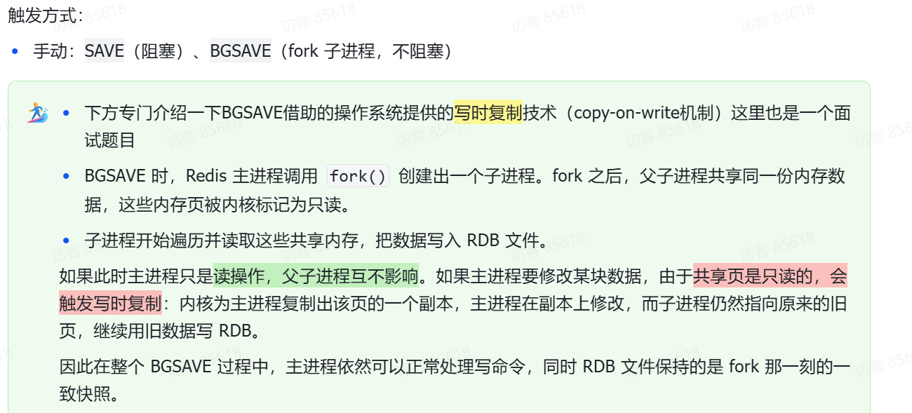
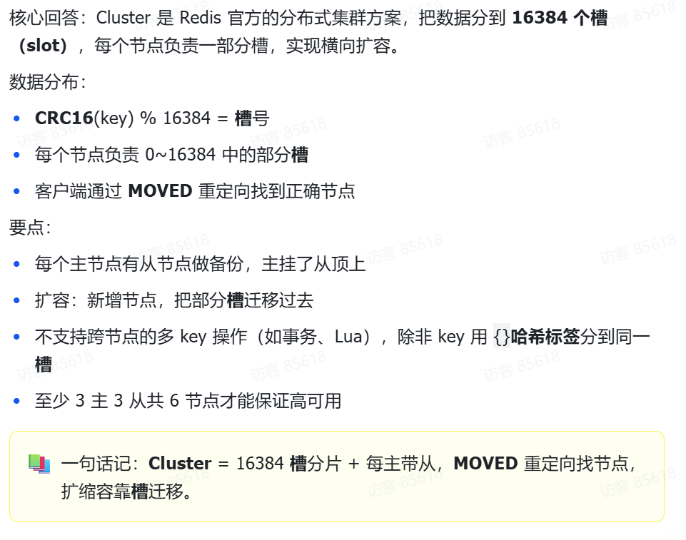
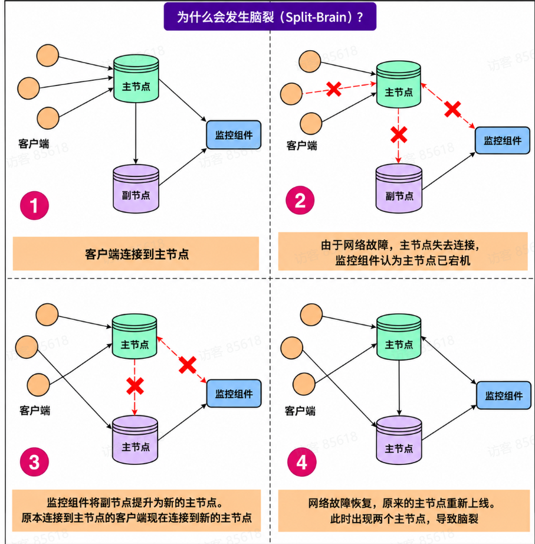
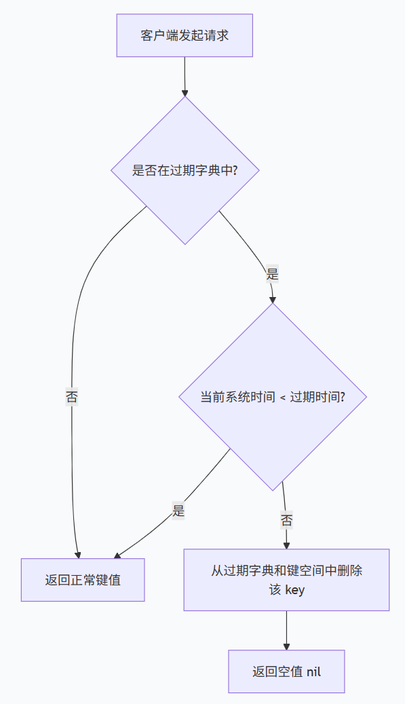
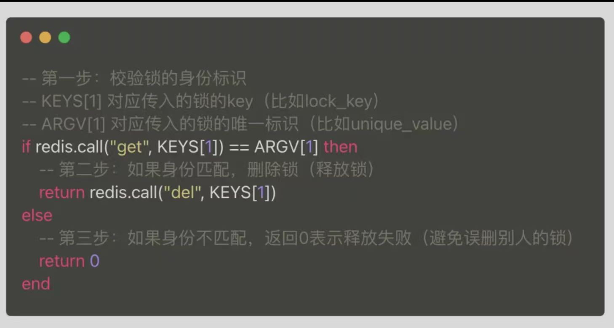
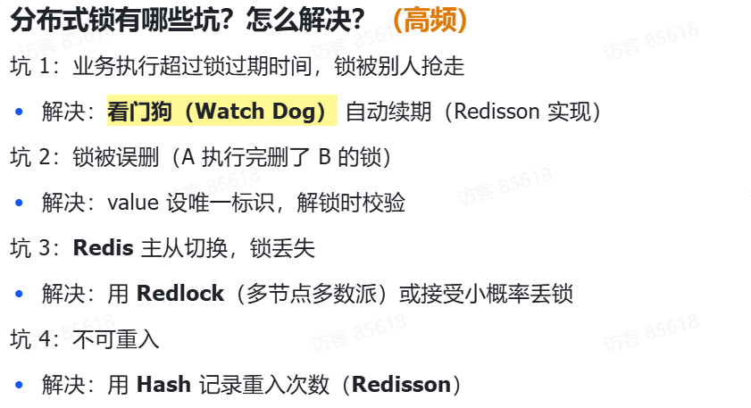
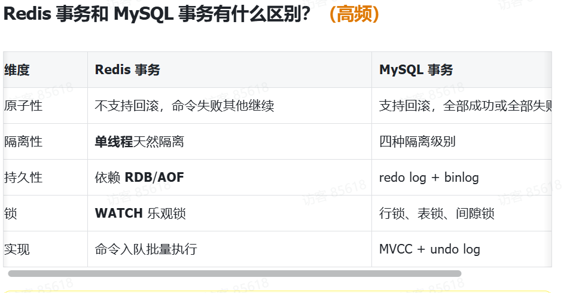
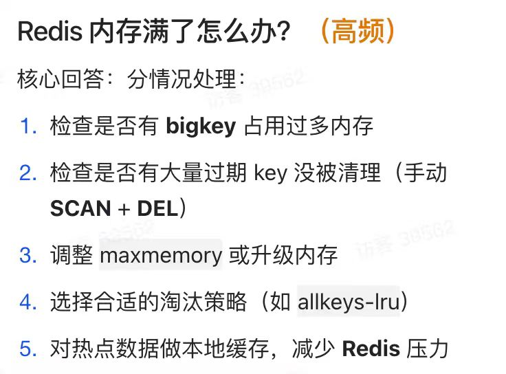

# Redis

Redis 是一个基于内存的 **Key-Value（键值）数据库**，也常被用作**缓存**、**消息队列**和**数据结构服务器**。

# 数据结构

### 简单动态字符串SDS

底层数据结构

```
struct sdshdr {
    int len;   // 记录字符串已使用的长度
    int free;  // 记录未使用的字节数
    char buf[]; // 存储实际数据的字节数组
}
```

相比于C字符串，SDS带来了几个关键优势：

- 获取长度更快 (O(1)复杂度)：因为有`len`属性直接记录了长度，不需要像C字符串那样遍历计数，效率极高。
  
- **二进制安全 (Binary Safe)**：SDS判断字符串结束的依据是`len`的长度，而不是C语言中的空字符`\0`。这意味着字符串中可以包含图片、视频等任何二进制数据。
	
- 杜绝缓冲区溢出：在对字符串进行修改（如追加）时，SDS的API会先检查空间是否足够，不够则自动扩容，从而避免了C语言中常见的缓冲区溢出风险。
  
- **高效的扩容策略**：为了减少频繁分配内存带来的性能损耗，SDS采用了**空间预分配**和**惰性空间释放**的策略
		
	- **空间预分配**：当字符串长度增长时，不仅会分配所需空间，还会额外分配未使用空间。如果修改后长度小于1MB，则预分配相同大小的空间；如果大于等于1MB，则固定多分配1MB空间
	- **惰性空间释放**：当字符串缩短时，多出的空间不会立即被回收，而是用`free`属性记录下来，以备后续使用

# 缓存

* ### 缓存淘汰

* ### 过期删除

* ### 缓存一致

* ### 缓存击穿

  要查的数据缓存里面没有，数据库里面有，本来这样的请求没问题，但是如果是热点服务，超级多个同样的请求同时涌入数据库，数据库就会挂了

* ### 缓存穿透

  要查一个缓存也没有，数据库也没有的数据，原本缓存命中率 90%+，数据库只承受 10% 的流量，现在数据库要承受 100% 的流量，然后**连接数、CPU、磁盘 I/O、内存、线程池**这些有限资源被耗尽。数据库就挂了

  #### 布隆过滤器

  

  把数据库里的信息提前存到这样一个二进制数组中，快速查询到数据库里没有这条信息，进行拦截，防止堵到数据库家门前

* ### 缓存雪崩

一大批被缓存的数据，同时失效，此时对于这一批的数据请求就全打到数据库上，导致数据库宕机。

**解决方案**

从Redis的角度：

•设置热点数据永不过期

•分析失效时间，尽量让失效时间点分散

•缓存预热，即在上线前，根据当天的情况分析，将热数据直接加载到缓存系统

### 如何保持缓存和数据库的一致性？

**先更新MySQL，再删除Redis缓存**

写操作很慢，读操作很快

这个方案可能的坑：

删缓存失败：把更新步骤放到MQ（消息队列）异步执行

极端并发窗口（读旧值和写新值交错）：延迟双删：删缓存，更新DB，休眠几百ms，再删一次


## Retis的持久化处理

持久化就是把数据从内存备份到磁盘

* RDB

  保存数据快照

  * 创建一个子进程
  * 隔一段时间备份一次
  * 缺点就是最近一次时间的数据可能会丢失

  

* AOF

  记录写操作日志

  

1. **`aof_buf`（AOF 缓冲区）**
   - 平时所有写命令都先写到这里。
   - 然后由后台线程根据 `appendfsync` 策略，刷到磁盘的 AOF 文件里。
   - 这是**正常流程**。
2. **`aof_rewrite_buf`（AOF 重写缓冲区）**
   - 这个缓冲区**只在 AOF 重写期间才启用**。
   - 它的作用是：**把重写期间新产生的写命令，临时存起来**。

## AOF重写

为了避免AOF文件越写越大，提供了AOF重写机制

当文件大小超过阈值，就会启动重写机制

**重写机制的妙处在于**，尽管某个键值对被多条写命令反复修改，最终也只需要根据这个「键值对」当前的最新状态，然后用一条命令去记录键值对，代替之前记录这个键值对的多条命令，这样就减少了 AOF 文件中的命令数量。最后在重写工作完成后，将新的 AOF 文件覆盖现有的 AOF 文件。

**为什么重写 AOF 的时候，不直接复用现有的 AOF 文件，而是先写到新的 AOF 文件再覆盖过去？**

因为如果 AOF 重写过程中失败了，现有的 AOF 文件就会造成污染，可能无法用于恢复使用。

所以 AOF 重写过程，先重写到新的 AOF 文件，重写失败的话，就直接删除这个文件就好，不会对现有的 AOF 文件造成影响。

### 三种写回操作

- **Always**，这个单词的意思是「总是」，所以它的意思是每次写操作命令执行完后，同步将 AOF 日志数据写回硬盘；
- **Everysec**，这个单词的意思是「每秒」，所以它的意思是每次写操作命令执行完后，主线程先通过 `write()` 将命令写入到 AOF 文件的内核缓冲区（page cache），然后由一个 **BIO 后台线程每隔一秒异步调用 `fsync()`**，把内核缓冲区的内容写回到硬盘；
- **No**，意味着不由 Redis 控制写回硬盘的时机，转交给操作系统控制写回的时机，也就是每次写操作命令执行完后，先将命令写入到 AOF 文件的内核缓冲区，再由操作系统决定何时将缓冲区内容写回硬盘。

### AOF的后台重写

##### 重写操作是很耗时的，所以重写的操作不能放在主进程里

#### 所以，Redis 的重写 AOF 过程是由后台子进程 bgrewriteaof 来完成的，这么做可以达到两个好处：

- 子进程进行 AOF 重写期间，主进程可以继续处理命令请求，从而避免阻塞主进程；
- **子进程带有主进程的数据副本（数据副本怎么产生的后面会说），这里使用子进程而不是线程，因为如果是使用线程，多线程之间会共享内存，那么在修改共享内存数据的时候，需要通过加锁来保证数据的安全，而这样就会降低性能。而使用子进程，创建子进程时，父子进程是共享内存数据的，不过这个共享的内存只能以只读的方式，而当父子进程任意一方修改了该共享内存，就会发生「写时复制」，于是父子进程就有了独立的数据副本，就不用加锁来保证数据安全。**

**`aof_rewrite_buf`（AOF 重写缓冲区）**

- 这个缓冲区**只在 AOF 重写期间才启用**。
- 它的作用是：**把重写期间新产生的写命令，临时存起来**。

## 混合持久化

先进行RDB，进行RDB的时间产生的写操作会放在缓冲区中，RDB完成后，缓冲区的写操作进入磁盘变成AOF。

恢复时，使用最新RDB进行AOF里面的操作形成数据

## 怎么做到高可用？

高可用：大多数情况下都是可用的，网络出点小差错也能继续使用

## 主从复制

主节点：能读能写

从节点：只能读


### 主从模式下主节点挂了怎么办？

#### 哨兵模式

哨兵**不是单个进程**，而是一组哨兵节点（通常 3 个或 5 个）

* 因为哨兵也可能会挂
* **多个哨兵一起投票**，才能确认主节点真的挂了，避免误判

#### 哨兵的核心功能

| 功能             | 说明                                   |
| :--------------- | :------------------------------------- |
| **监控**         | 持续检查主节点、从节点是否存活         |
| **通知**         | 节点出问题时，通知管理员或其他系统     |
| **自动故障转移** | 主挂了，自动选新主，让其他从节点连新主 |
| **配置中心**     | 客户端向哨兵询问“当前主节点是谁        |

## 故障转移的完整流程

**（1）主观下线（SDOWN）**

- 某个哨兵发现主节点在 `down-after-milliseconds` 内没响应。
- 它自己认为主节点挂了，这叫**主观下线**。

**（2）客观下线（ODOWN）**

- 这个哨兵去问其他哨兵：“你们也觉得主挂了吗？”
- 如果**超过 quorum 数量**的哨兵都认为主挂了，就判定为**客观下线**。
- 这时才真正开始故障转移。

**（3）选举领头哨兵**

- 多个哨兵中，选一个出来负责执行故障转移。
- 用 Raft 类似的投票机制选出 leader。

**（4）选新主**

领头哨兵从从节点里挑一个最合适的当新主，挑选依据：

1. 优先级（`replica-priority`）高的优先。
2. 复制偏移量最大的优先（数据最新）。
3. runid 最小的优先（兜底规则）。

**（5）切换**

- 把选中的从节点执行 `SLAVEOF NO ONE`，升级为主。
- 让其他从节点 `SLAVEOF` 新主。
- 旧主如果恢复，也让它变成新主的从节点。

**（6）通知客户端**

- 哨兵把新主地址推送给客户端。
- 客户端后续写请求发到新主。

### 集群

复习一下：用我们刚才所介绍的主从复制和哨兵集群来看。需要每一台机器都存储完整的所有数据。如果用户的数据特别大，一台机子都存不下。那么这种方法都是无效的。

为了处理这种情况，Redis就提出了Cluster这样一个机制。

自动将你的数据切分给多节点存储

即使这些节点中一部分宕机，也可以继续执行数据操作。

分区策略：

我们知道，Redis数据其实都是键值对。值类型可能是String、哈希表、链表等等，但是我们可以通过键去插入嘛，对吧？

分区策略：采用虚拟槽，所有键通过CRC16校验函数对16384取模，决定数据分配到哪个槽位。如果说运气好的话，这个数据就可以分到16384份（slot）。

那每个Redis Cluster节点负责一部分槽位数据的存储

并且该节点可以结合之前讲到的主从复制模式，将分配给它的数据进行复制。

那么怎么查询呢？

之前我们是问主库要，或者说从库要。

现在，每个节点都会存储整个集群节点的信息，这些信息被称为元信息。

该节点存储的元数据包括：在该节点视角下，各节点存储的槽数据、各节点的Master和Slave状态，以及各节点是否存活。

元数据信息的传播：Gossip协议中，每个节点都把自己的数据信息通过这个协议散布出去。

具体过程：Gossip协议是周期性的，每隔一定时间执行一次。所有被感染节点选择K个邻接节点散布信息。

关于Cluster的扩容、缩容：由于集群数据可能出现服务器扩容，数据太多了就加节点；数据服务器缩容，数据太少就减少节点，避免浪费。

在该过程中，数据会发生迁移，所以会出现这种情况：某个槽的一部分数据在原来节点上。



#### 集群脑裂是什么，怎么解决？



**解决方案：**

- 配置 `min-replicas-to-write`：主节点必须有 N 个从节点在线才允许写
- 配置 `min-replicas-max-lag`：从节点延迟超过阈值时，主节点拒绝写

**防止主节点把数据写入到“已经严重滞后”的从节点上，保证数据同步的时效性。**

`min-replicas-to-write` 只检查从节点**是否在线**，但“在线”不代表“数据是最新的”。一个从节点可能网络很卡、负载很高，虽然 TCP 连接还在，但复制进度已经落后主节点很多。

如果只靠第一条，主节点可能觉得“我有 3 个从节点在线，可以写”，但实际上这 3 个从节点都落后了几十秒的数据。这时候如果主节点宕机，切换到从节点，就会**丢失大量数据**。

- 这样网络分区时，旧主没有足够从节点就停止写，避免脏数据


## 过期删除策略

Redis 是可以对 key 设置过期时间的，因此需要有相应的机制将已过期的键值对删除，而做这个工作的就是过期键值删除策略

### 过期字典

每当我们对一个 key 设置了过期时间时，Redis 会把该 key 带上过期时间存储到一个过期字典（expires dict）中，也就是说「过期字典」保存了数据库中所有 key 的过期时间。

**过期字典数据结构结构如下**：

- 过期字典的 key 是一个指针，指向某个键对象；
- 过期字典的 value 是一个 long long 类型的整数，这个整数保存了 key 的过期时间；

#### 如何判定 key 已过期了？ 



### 过期删除策略有哪些

* #### 定时删除

  定时删除策略的做法是，在设置 key 的过期时间时，同时创建一个定时事件，当时间到达时，由事件处理器自动执行 key 的删除操作。

  定时删除策略的优点：

  - 可以保证过期 key 会被尽快删除，也就是内存可以被尽快地释放。因此，定时删除对内存是最友好的。

  定时删除策略的缺点：

  - 在过期 key 比较多的情况下，删除过期 key 可能会占用相当一部分 CPU 时间，在内存不紧张但 CPU 时间紧张的情况下，将 CPU 时间用于删除和当前任务无关的过期键上，无疑会对服务器的响应时间和吞吐量造成影响。所以，定时删除策略对 CPU 不友好。

* #### 惰性删除

  惰性删除策略的做法是，不主动删除过期键，每次从数据库访问 key 时，都检测 key 是否过期，如果过期则删除该 key。

  惰性删除策略的优点：

  - 因为每次访问时，才会检查 key 是否过期，所以此策略只会使用很少的系统资源，因此，惰性删除策略对 CPU 时间最友好。

  惰性删除策略的缺点：

  - 如果一个 key 已经过期，而这个 key 又仍然保留在数据库中，那么只要这个过期 key 一直没有被访问，它所占用的内存就不会释放，造成了一定的内存空间浪费。所以，惰性删除策略对内存不友好。

* #### 定期删除

  定期删除策略的做法是，每隔一段时间「随机」从数据库中取出一定数量的 key 进行检查，并删除其中的过期 key。

  定期删除策略的优点：

  - 通过限制删除操作执行的时长和频率，来减少删除操作对 CPU 的影响，同时也能删除一部分过期的数据减少了过期键对空间的无效占用。

  定期删除策略的缺点：

  - 内存清理方面没有定时删除效果好，同时没有惰性删除使用的系统资源少。
  - 难以确定删除操作执行的时长和频率。如果执行的太频繁，定期删除策略变得和定时删除策略一样，对 CPU 不友好；如果执行的太少，那又和惰性删除一样了，过期 key 占用的内存不会及时得到释放。

### **Redis 过期删除策略是什么？**

「**惰性删除+定期删除**」

#### 详细说说 Redis 的定期删除的流程：

1. 从过期字典中随机抽取 20 个 key；
2. 检查这 20 个 key 是否过期，并删除已过期的 key；
3. 如果本轮检查的已过期 key 的数量，超过 5 个（20/4），也就是「已过期 key 的数量」占比「随机抽取 key 的数量」大于 25%，则继续重复步骤 1；如果已过期的 key 比例小于 25%，则停止继续删除过期 key，然后等待下一轮再检查。

可以看到，定期删除是一个循环的流程。

**那 Redis 为了保证定期删除不会出现循环过度，导致线程卡死现象，为此增加了定期删除循环流程的时间上限，默认不会超过 25ms。**

## 内存淘汰策略

前面说的过期删除策略，是删除已过期的 key，而当 Redis 的运行内存已经超过 Redis 设置的最大内存之后，则会使用内存淘汰策略删除符合条件的 key，以此来保障 Redis 高效的运行。

### 如何设置 Redis 最大运行内存？

在配置文件 redis.conf 中，可以通过参数 `maxmemory <bytes>` 来设定最大运行内存，只有在 Redis 的运行内存达到了我们设置的最大运行内存，才会触发内存淘汰策略。不同位数的操作系统，maxmemory 的默认值是不同的：

- 在 64 位操作系统中，maxmemory 的默认值是 0，表示没有内存大小限制，那么不管用户存放多少数据到 Redis 中，Redis 也不会对可用内存进行检查，直到 Redis 实例因内存不足而崩溃也无作为。
- 在 32 位操作系统中，maxmemory 的默认值是 3G，因为 32 位的机器最大只支持 4GB 的内存，而系统本身就需要一定的内存资源来支持运行，所以 32 位操作系统限制最大 3 GB 的可用内存是非常合理的，这样可以避免因为内存不足而导致 Redis 实例崩溃。


#### Redis 内存淘汰策略共有八种，这八种策略大体分为「不进行数据淘汰」和「进行数据淘汰」两类策略。

**1、不进行数据淘汰的策略**

**noeviction**（Redis3.0之后，默认的内存淘汰策略）：它表示当运行内存超过最大设置内存时，不淘汰任何数据，这时如果有新的数据写入，会报错通知禁止写入，不淘汰任何数据，但是如果没用数据写入的话，只是单纯的查询或者删除操作的话，还是可以正常工作。

**2、进行数据淘汰的策略**

针对「进行数据淘汰」这一类策略，又可以细分为「在设置了过期时间的数据中进行淘汰」和「在所有数据范围内进行淘汰」这两类策略。

**在设置了过期时间的数据中进行淘汰：**

- **volatile-random**：随机淘汰设置了过期时间的任意键值；
- **volatile-ttl**：优先淘汰更早过期的键值。
- **volatile-lru**（Redis3.0之前，默认的内存淘汰策略）：淘汰所有设置了过期时间的键值中，最久未使用的键值；
- **volatile-lfu**（Redis 4.0 后新增的内存淘汰策略）：淘汰所有设置了过期时间的键值中，最少使用的键值；

**在所有数据范围内进行淘汰：**

- **allkeys-random**：随机淘汰任意键值；
- **allkeys-lru**：淘汰整个键值中最久未使用的键值；
- **allkeys-lfu**（Redis 4.0 后新增的内存淘汰策略）：淘汰整个键值中最少使用的键值。


# Redis锁

#### 存在的问题

* #### 锁争抢--多人争抢同一把锁

* #### 僵尸锁--锁不释放

* #### 锁过期--节点还没执行完任务，锁就过期了

* #### 锁存储不可靠--单节点部署的隐患

#### 加锁机制

**第一层**

**SET lock_key unique_value NX EX 30**

NX  ：not exists 解决了争抢锁的问题

EX 30 ：解决了僵尸锁的问题

unique_value：设为唯一标识（如 UUID，释放时校验，防止误删别人的锁）

**第二层**（**Redlock 算法**）

给Redis锁部署至少三个节点（实际常用5个）只有超过半数节点都成功给资源加锁时，资源才算真正拿到锁

（可以联想哨兵机制，都是一样的策略，来解决单节点不稳定的问题）

#### 释放锁机制

使用脚本将校验身份标识（看是不是自己的锁）和删除锁操作封装成原子操作，避免误删别人的锁引发混乱



#### 实际应用中使用Redis锁

* 简单场景使用单节点锁

* 长任务用看门狗

  当任务节点成功抢到锁之后，系统会在节点上启动一个后台线程，会每隔固定一段时间主动检查：主人，这把锁还用吗？

* 支付，下单等核心业务使用Redlock算法，高可用锁

#### 锁的问题和解决方法？



# 事务

**Redis 事务 = 把多条命令打包，用 `MULTI` 入队、`EXEC` 一次性、按顺序、不被打断地执行。**

- Redis 事务**不支持回滚**：命令入队时语法错误会全部不执行，但执行时某个命令失败，其他命令仍继续执行
- 事务执行期间不会被其他客户端打断（**单线程**保证）
- **WATCH** 实现乐观锁，失败可重试

#### redis怎么保证事务的原子性？

* lua脚本：如果要保证多个相关操作不被其他命令打断，可以考虑用 **Lua 脚本**

* redis事务：也就是 **MULTI 和 EXEC**，把多个命令放在一起执行。

  MULTI 开启事务后，后面的命令先进入队列，直到收到 EXEC 才按顺序执行

  保证一个事务的多个指令之间不会插入别的指令，只能保证指令的顺序执行，不能保证所有指令都成功（没有回滚）

#### Pipeline 是什么？它能保证原子性吗？

Pipeline，也就是流水线，主要用来**减少网络往返和网络读写的开销**。

不是干这个用的哈


#### watch乐观锁

WATCH 会监视指定的 key。如果这些 key 在 WATCH 之后、EXEC 之前发生变化，EXEC 就会放弃执行整个事务，返回空结果，由客户端决定是否重新读取并重试

WATCH 不会锁住这个 key，也不会阻止其他客户端修改它，所以叫**乐观锁**

需要注意，**WATCH 和事务命令要使用同一条连接**。EXEC 结束后会取消监视，，重试时要重新 WATCH；竞争激烈时可能频繁失败，因此要有重试上限和退避，不能无限重试。

#### 和MySQL有什么区别？




# 严肃背诵全文

* ## Redis为什么这么快？

  * 纯内存操作

  * 协议比较简单

    RESP协议（客户端和服务器）

  * 单线程操作能够

    * 避免上下文切换
    * 避免锁竞争

  * 实现IO多路复用（epoll）

* ### **Redis 为什么用单线程？单线程为什么更快？**

  * Redis 单线程指的是命令执行是单线程的（文件事件分派器）
  * 快慢方面要看整个过程拖慢速度的环节在哪里，因为数据传输的瓶颈在内存和网络，不在CPU，所以使用单线程避免了锁竞争和上下文切换就会更快

* ### RDB 持久化是什么？

* ### AOF 持久化是什么？ 

* ### RDB 和 AOF 如何选择？ 

* ### AOF 重写的原理是什么？ 

  